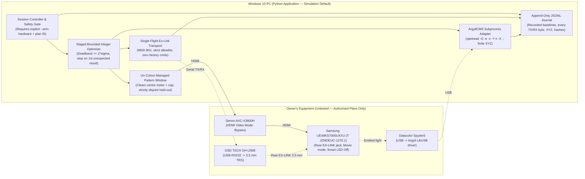

| Field | Value |
|---|---|
| Title | TV-side auto-calibration of the Samsung UE49KS7000UXXU: independent feasibility study |
| Produced by | AI: Antigravity (Google) |
| Original date | 2026-10-26 |
| Imported | 2026-10-26, by Antigravity (Google) |
| How obtained | Authored directly in PR #19 on branch `antigravity/feasibility-study`, and updated before merge under owner ruling `S-032` to incorporate cross-vendor review corrections (`Claude Code` and `Codex`) and same-day owner equipment confirmations (`S-032`) |
| Fidelity | Verbatim report as amended before merge under S-032 |
| Ledger ID | S-024 |

# TV-Side Auto-Calibration of the Samsung UE49KS7000UXXU: Independent Feasibility Study

> **Important status notice (read first):**
> - **Equipment test status:** **Nothing in this study has been tested on the owner's equipment.** Every operational hardware behaviour discussed below is **Not tested** unless and until the owner explicitly authorises a written test plan under [AGENTS.md section 7](../../AGENTS.md#7-equipment-safety-rule-6). Same-day look-only owner confirmations and photograph transcriptions ([S-032](../../LEDGER.md#1-sources), [C-074](../../LEDGER.md#2-claims)–[C-076](../../LEDGER.md#2-claims)) record physical port labels, version numbers and leaflet text only (`N/A` for descriptive identity; **Not tested** for electrical or command compatibility).
> - **Research boundaries respected:** No commands were sent to the TV or Denon receiver, no serial or USB instrument ports were opened, no ArgyllCMS binaries were installed or executed, no test patterns were displayed, no service menu was entered, and no home network scan was performed. All source-code and protocol checks were strictly software-only.
> - **Provenance vs equipment proof:** Primary documentation and source code establish what tools and published worksheets specify; they do **not** prove how the owner's `UE49KS7000UXXU` firmware (`T-JZMDEUC-1270.1`), `SH-U35B` cable, `Spyder5`, PC or `AVC-X3800H` behave in practice.

---

## 1. Plain-English Verdict

The project asks whether we can build a **free, open-source Windows Python application** that automatically calibrates the **television's own picture settings** over **Samsung Ex-Link** (a wired serial control connection, [D-006](../../LEDGER.md#3-decisions)), following the owner's required loop ([D-013](../../LEDGER.md#3-decisions)):

**Display a known colour patch → measure it with the Spyder5 → calculate an adjustment → change a TV picture setting through Ex-Link → exit the TV menu → wait for the picture to settle → measure again**

with **SDR Rec.709** (standard HD colour primaries), **D65 white** (standard daylight white) and **BT.1886** (the ITU-R standard brightness/electro-optical transfer curve for SDR video) as first priority ([D-001](../../LEDGER.md#3-decisions)), and within a **£25.00 total hardware budget** (£15.99 spent, **£9.01 remaining**, [C-008](../../LEDGER.md#2-claims)).

Because **automatic operation** and **measurement accuracy** depend on different physical bottlenecks, they require separate verdicts using the four-level scale (`feasible`, `conditionally feasible`, `blocked pending evidence/testing`, `infeasible under the present constraints`):

| Objective | Verdict | Plain-English reason |
|---|---|---|
| **1. Automatic closed-loop TV-side operation over Ex-Link** | **Blocked pending evidence/testing** *(conditionally feasible only if remaining look-only checks [T-001](../../LEDGER.md#5-outstanding-tests)/[T-002](../../LEDGER.md#5-outstanding-tests) and Stage 4 serial test [T-006](../../LEDGER.md#5-outstanding-tests) pass)* | We can build the Python software, ArgyllCMS wrapper, test-pattern window and numerical optimiser for £0 using free open-source libraries, and the owner has now confirmed ([S-032](../../LEDGER.md#1-sources), [C-074](../../LEDGER.md#2-claims), [C-076](../../LEDGER.md#2-claims)) that a physical **3.5 mm `EX-LINK` socket is present on the rear of the `UE49KS7000UXXU` panel** (not on the One Connect box) and that the delivered cable is **`Model: SH-U35B`**. **However, no exact-model primary source proves that firmware `T-JZMDEUC-1270.1` accepts public consumer picture-calibration commands over that port without service-menu changes.** Samsung's official UK `UE49KS7000U` manuals omit any mention of `Ex-Link` or `RS-232` ([S-025](../../LEDGER.md#1-sources), [C-062](../../LEDGER.md#2-claims)), DSD TECH's `SH-U35B` guides describe the cable as RS-232 (`Tip = PC RX, Ring = PC TX, Sleeve = GND`) without stating its voltage transceiver or signal swing ([S-026](../../LEDGER.md#1-sources), [S-032](../../LEDGER.md#1-sources), [C-064](../../LEDGER.md#2-claims), [C-076](../../LEDGER.md#2-claims)), and Portrait Displays' archived 2016 SUHD guide ([S-027](../../LEDGER.md#1-sources), [C-065](../../LEDGER.md#2-claims)) selects Samsung's unpublished **"Samsung DDC"** control method — leaving public `08 22` command support **unestablished** until an owner-authorised serial test ([T-006](../../LEDGER.md#5-outstanding-tests)). |
| **2. Achievable SDR accuracy — relative improvement using the TV's own controls** | **Conditionally feasible** *(subject to Ex-Link control working and owner acceptance of an unvalidated quantum-dot spectral correction under [Q-016](../../LEDGER.md#6-open-questions))* | **If** Ex-Link controls work, closed-loop optimisation with the `Spyder5` can realistically make mid-to-bright greys (`20%–100%` stimulus) much more neutral (removing visible colour casts relative to the chosen correction), align mid-tone gamma closer to `BT.1886` (for an explicitly chosen black-level assumption under [Q-014](../../LEDGER.md#6-open-questions)), and pull oversaturated wide-gamut colours closer to `Rec.709` using 2-point White Balance, Gamma and `Colour Space: Custom`. This relies on passing uppercase `-Y n` to ArgyllCMS `spotread` so QLED `.ccss` files with `TECHNOLOGY "Unknown"` do not override `-y` into refresh-synchronised measurement ([C-068](../../LEDGER.md#2-claims)) and on gating `10p White Balance` behind a reversible single-interval probe in case this unit shows the `"contrast-aligned"` behaviour HDTVTest reported on its UK review sample ([C-073](../../LEDGER.md#2-claims)). |
| **3. Achievable SDR accuracy — independently demonstrated ("validated") absolute reference accuracy and near-black calibration** | **Infeasible under the present constraints** *(without access to an external reference spectrophotometer; [Q-001](../../LEDGER.md#6-open-questions), [Q-016](../../LEDGER.md#6-open-questions))* | Two hard physical limits of the existing `Spyder5` cannot be solved in software or within £9.01: **(a)** No `2016 Samsung SUHD` spectral sample (`.ccss`) was found in ArgyllCMS V3.5.0 or in DisplayCAL's `SAM`/`SEC` database queries on `2026-10-26` ([C-070](../../LEDGER.md#2-claims)), and a borrowed `2018 Q9 QLED` `.ccss` leaves potential 2016-vs-2018 quantum-dot spectral differences and unit-specific `Spyder5` filter ageing unverified (`[AI: Antigravity hypothesis, unverified]`); without a reference spectrophotometer (an instrument that measures light wavelength by wavelength), a systematic `D65` offset (`[AI: Antigravity illustrative estimate: roughly ΔE00 ≈ 1.5–4.0+, unverified]`) cannot be independently measured or ruled out. **(b)** ChromaPure's `Spyder5` benchmark places its low-light luminance-consistency limit at **`0.38 cd/m²`** ([S-031](../../LEDGER.md#1-sources), [C-072](../../LEDGER.md#2-claims)), nearly ten times brighter than HDTVTest's `0.04 cd/m²` native black on a sample UK `UE49KS7000`, preventing direct measurement of native black and `0%–5%` `BT.1886` stimulus (`5% ≈ 0.31 cd/m²`) and leaving `10%` (`0.93 cd/m²`) subject to chromaticity noise checks in [T-003](../../LEDGER.md#5-outstanding-tests). |

### Bottom line in one paragraph

Do **not** write the full calibration application yet, and do **not** buy any more hardware. In [S-032](../../LEDGER.md#1-sources) (`2026-10-26`), the owner confirmed the physical **3.5 mm `EX-LINK` socket on the rear of the `UE49KS7000UXXU` panel**, firmware **`T-JZMDEUC-1270.1`**, PC **`Windows 10 Home 22H2` + `NVIDIA GTX 1080 8GB` (`Driver 582.78`)**, and the delivered **`SH-U35B` cable and leaflet** ([C-074](../../LEDGER.md#2-claims)–[C-076](../../LEDGER.md#2-claims)). The shortest path to proving or disproving feasibility is now: (1) complete the remaining **look-only** menu and connection items in [T-001](../../LEDGER.md#5-outstanding-tests)/[T-002](../../LEDGER.md#5-outstanding-tests) (picture-menu controls/ranges, `10p` vs `20p` white balance, HDMI/Denon path, and Spyder5 cable reach — **still plugging nothing in**), (2) build the offline software-only codec and safety suite ([T-009](../../LEDGER.md#5-outstanding-tests)), and (3) propose a minimal, reviewed, owner-authorised serial and electrical check ([T-006](../../LEDGER.md#5-outstanding-tests)) to settle whether firmware `T-JZMDEUC-1270.1` responds over Ex-Link under [D-006](../../LEDGER.md#3-decisions).

---

## 2. Decisive Dependency Table

Every material conclusion below separates **provenance** (who or what states it), **applicability** (exact model/firmware vs related/generic), and **equipment test status** (tested on the owner's equipment vs not tested). Technical terms are explained in plain English on first use and in the [workflow glossary](../workflow.md).

| # | Requirement | Evidence (Provenance · Applicability · Equipment test status) | Key uncertainty | Current status | Next decisive check |
|---|---|---|---|---|---|
| **A1** | **Physical Ex-Link socket on `UE49KS7000UXXU`** | **Owner & AI photo transcription:** Owner statement and rear-panel photograph in [S-032](../../LEDGER.md#1-sources) ([C-074](../../LEDGER.md#2-claims)) · *Owner's exact unit (`UE49KS7000UXXU`)* · **N/A (descriptive label); port operation Not tested**. **Primary:** Samsung UK User Manual `BN68-07864G-00` pp. 5, 8, 10–12 & UK e-Manual `ENG-JZDVBEUK-1.1.3` ([S-025](../../LEDGER.md#1-sources), [C-062](../../LEDGER.md#2-claims)) · *Exact model (`UE49KS7000U`)* · **N/A**. | UK manuals omit `Ex-Link`, illustrating `HDMI`/`USB`/`Optical` on the external `One Connect` box (called `One Connect Mini` in `S-031`; no 3.5 mm jack) and `LAN`/`CI` behind the rear `Cover Terminal`. `S-032` resolves the physical-port question: a round 3.5 mm jack printed **`EX-LINK`** sits on the rear of the TV panel (between `USB (IoT EXTEND)` and `LAN`), not on the One Connect box. Whether it is electrically active is **Not tested**. | **Physical socket confirmed ([C-074](../../LEDGER.md#2-claims)); electrical/serial operation Not tested** | **[T-006](../../LEDGER.md#5-outstanding-tests)** (reviewed, owner-authorised electrical & serial test). |
| **A2** | **Electrical compatibility & pinout of purchased DSD TECH cable ([C-008](../../LEDGER.md#2-claims))** | **Primary (cable):** DSD TECH `SH-U35B` online User Guide pp. 2–5 ([S-026](../../LEDGER.md#1-sources), [C-064](../../LEDGER.md#2-claims)); **Owner & AI photo transcription:** delivered `SH-U35B` leaflet `A100033` `P2–P4` ([S-032](../../LEDGER.md#1-sources), [C-076](../../LEDGER.md#2-claims)) · *Exact delivered cable model* · **Not tested**. **Primary (TV generic):** Samsung RS-232 Worksheet p. 2 ([S-015](../../LEDGER.md#1-sources), [C-021](../../LEDGER.md#2-claims)) · *Generic consumer TV* · **Not tested**. | Both `S-026` (pp. 2–5) and the delivered `SH-U35B` leaflet (`P2–P4`, `S-032`) describe the cable as an **RS-232** serial cable (`FTDI FT232RL`/`FT232RNL`) wired **Tip = PC RX (device TX), Ring = PC TX (device RX), Sleeve = GND**, matching `S-015` p. 2 (`DB9 pin 2 → Tip, pin 3 → Ring, pin 5 → Sleeve`). However, **neither document names a separate RS-232 voltage-level transceiver chip or states voltage swing** (an unbuffered FT232R outputs logic-level TTL, `0–3.3 V`/`5 V`, rather than bipolar `±3 V..±15 V` RS-232), and Samsung publishes no electrical spec for the UK `KS7000` `EX-LINK` port. | **Cable arrived & pinout matches on paper ([C-076](../../LEDGER.md#2-claims)); voltage levels & TV compatibility Not tested** | **[T-006](../../LEDGER.md#5-outstanding-tests)** (establish electrical-level verification/precautions in reviewed plan **before** TV connection). |
| **A3** | **Basic serial framing, UART mode & `03 0C F1` acknowledgement** | **Primary:** `S-015` pp. 1–3 ([C-057](../../LEDGER.md#2-claims), [C-066](../../LEDGER.md#2-claims)); **Primary for code / Secondary for TV:** `samsung-exlink` ([S-007](../../LEDGER.md#1-sources), [C-009](../../LEDGER.md#2-claims), [C-010](../../LEDGER.md#2-claims)) and SamyGO posts ([S-028](../../LEDGER.md#1-sources)) · *Generic / related 2016 `KS7000`* · **Not tested**. | `9600 8N1` (`9600` bits/s, 8 data bits, no parity, 1 stop bit), 7-byte frame `08 22 <cmd1> <cmd2> <cmd3> <val> <chk>` (`chk = (-sum) mod 256`, two's-complement checksum), 3-byte `03 0C F1` ACK / `03 0C FF` NACK. SamyGO `p=107012` (`stich86`) and `p=107013` (`zoelechat`) describe a `KS7000` whose serial jack had been set to `Debug` mode, and `S-015` p. 1 **shows `UART` selected in its USB-serial setup example** (not a proven factory default); whether the owner's `T-JZMDEUC-1270.1` firmware ([C-074](../../LEDGER.md#2-claims)) answers in `UART` mode without service-menu entry ([X-002](../../LEDGER.md#4-disagreements)) is unknown. | **Unverified on `T-JZMDEUC-1270.1`; Not tested** | **[T-009](../../LEDGER.md#5-outstanding-tests)** (software-only codec/safety test) → **[T-006](../../LEDGER.md#5-outstanding-tests)** (benign command check with **no** service-menu entry). |
| **A4** | **Ordinary remote-key commands (`KEY_EXIT` for [D-013](../../LEDGER.md#3-decisions))** | **Primary:** `S-015` pp. 4–5 (`cmd1=0x0d, cmd2=0x00, cmd3=0x00`, `KEY_EXIT=0x2d` → `08 22 0d 00 00 2d 9c`) · *Generic consumer TV* · **Not tested**. | `S-015` p. 5's `0x0e 0x01` is `Enable/Disable Cmd Result OSD` (command-result feedback banner), **not** a user-menu dismissal command ([C-066](../../LEDGER.md#2-claims)). Whether `08 22` direct picture setters draw an on-screen slider on `T-JZMDEUC-1270.1` and whether `KEY_EXIT` cleanly dismisses open menus without side effects must be observed on hardware. | **Not tested** | **[T-006](../../LEDGER.md#5-outstanding-tests)** (verify `KEY_EXIT` closes an open user menu cleanly under owner observation). |
| **A5** | **Direct Ex-Link access to calibration controls, encodings, persistence & restoration** | **Primary:** `S-015` p. 4 ([C-057](../../LEDGER.md#2-claims), [C-060](../../LEDGER.md#2-claims)); **Secondary:** Archived Portrait 2016 SUHD guide ([S-027](../../LEDGER.md#1-sources), [C-065](../../LEDGER.md#2-claims)) & `phillipsnick/samsung-tv` ([S-028](../../LEDGER.md#1-sources), [C-067](../../LEDGER.md#2-claims)) · *Generic / later 2020+ vs 2016 "Samsung DDC"* · **Not tested**. | **Highest technical risk.** Portrait (`S-027`) selects `"Control Method: Samsung DDC"` (`Full DDC Reset`, `Expert Mode` toggle, `Cal Day`/`Cal Night`, wire bytes unpublished), **leaving public `08 22` consumer picture-command support unestablished**. `S-015` reflects later 2020+ menu naming (`Brightness 0~50`, `Shadow Detail -5~+5`), leaves signed `-50..+50` / `-3..+3` wire encoding unspecified, has a `10p WB Reset` byte anomaly (`0x00 0x1b` vs `0x07 0x1b`), uses stateful selector+value pairs for `10p WB` and `CMS`, and documents **no picture-setting readback**. | **Blocked pending hardware test ([Q-006](../../LEDGER.md#6-open-questions))** | **[T-001](../../LEDGER.md#5-outstanding-tests)** (record menu controls/ranges) → **[T-006](../../LEDGER.md#5-outstanding-tests)** (test one reversible unsigned control first; stop on first unexpected result). |
| **B1** | **Programmatic `Spyder5` readings via ArgyllCMS on Windows** | **Primary:** ArgyllCMS V3.5.0 docs & C source `spectro/spotread.c`, `spectro/spyd2.c`, `spectro/inst.h`, `spectro/disptechs.c`, `xicc/ccss.c` ([S-014](../../LEDGER.md#1-sources), [S-029](../../LEDGER.md#1-sources), [C-055](../../LEDGER.md#2-claims), [C-056](../../LEDGER.md#2-claims), [C-068](../../LEDGER.md#2-claims), [C-069](../../LEDGER.md#2-claims)) · *Exact meter (`Spyder5`, `hwver == 10`)* · **Not tested**. | Requires ArgyllCMS LibUSB/WinUSB driver (conflicts with Datacolor software and RGB-lighting services). In V3.5.0 C source, QLED `.ccss` files with `TECHNOLOGY "Unknown"` (`disptechs.c` `refr = 1`) override lowercase `-y` (`spyd2.c:3235`) and put the `Spyder5` into inline refresh-synchronised measurement (`inst.h:611,615`, `spyd2.c:3113–3127`; see [X-011](../../LEDGER.md#4-disagreements)); **uppercase `-Y n`** restores non-refresh mode, `-N` warns as unsupported (`C-068`), and `-O` must precede flags if a logfile is passed (`spotread.c:1034`). Aborting a read can leave the meter in a `"borked state"` (`spyd2.c:2973`; `C-069`). | **Supported in primary code; Not tested on owner's PC** | **[T-003](../../LEDGER.md#5-outstanding-tests)** (authorised driver check, `spotread -O -e -x -Y n` repeatability, dark-floor and clean-exit check). |
| **B2** | **Spectral correction (`.ccss` / `.ccmx`) & low-light floor on 2016 SUHD quantum dots** | **Primary:** ArgyllCMS `spyd2.c` (`L1806–1819, L2248–2253, L2347, L3687–3773`) & DisplayCAL CCSS database ([S-029](../../LEDGER.md#1-sources), [C-070](../../LEDGER.md#2-claims)); **Secondary:** ChromaPure/CurtPalme benchmark & HDTVTest `UE49KS7000` review ([S-031](../../LEDGER.md#1-sources), [C-072](../../LEDGER.md#2-claims)) · *Exact meter; proxy 2018 QLED display* · **Not tested**. | No `2016 SUHD`/`KS7000`/`KS8000` `.ccss` was found in ArgyllCMS V3.5.0 or DisplayCAL (`SAM`: `307`, `SEC`: `42` entries on `2026-10-26`); OEM modes (`f, L, e, B, x`) omit quantum-dot LED. DisplayCAL's `Samsung Q9` (2018) `.ccss` is an unvalidated proxy. ChromaPure's low-light luminance-consistency floor is **`0.38 cd/m²`** vs `0.04 cd/m²` sample TV black ([C-072](../../LEDGER.md#2-claims)). Standard 3-channel `spotread` `XYZ` discards the `Spyder5`'s 7 sensor channels (`p->cal_A`) and cannot be re-scored with a different `.ccss` ([C-070](../../LEDGER.md#2-claims)). | **Relative calibration viable; validated absolute accuracy blocked ([Q-001](../../LEDGER.md#6-open-questions), [Q-016](../../LEDGER.md#6-open-questions))** | **Owner decision [Q-001](../../LEDGER.md#6-open-questions)/[Q-016](../../LEDGER.md#6-open-questions)** + **[T-004](../../LEDGER.md#5-outstanding-tests)** (record correction hashes/limits; comparison alone is not validation). |
| **C1** | **Unaltered Windows → GPU → Denon `AVC-X3800H` → TV test-patch signal path & [D-013](../../LEDGER.md#3-decisions) settle delay** | **Owner:** `Windows 10 Home 22H2`, `NVIDIA GTX 1080 8GB`, `GeForce Driver 582.78` ([S-032](../../LEDGER.md#1-sources), [C-075](../../LEDGER.md#2-claims)) · *Owner's PC* · **N/A**. **Primary:** Microsoft Learn ACM ([S-017](../../LEDGER.md#1-sources), [C-059](../../LEDGER.md#2-claims)), ArgyllCMS `dispwin` ([S-029](../../LEDGER.md#1-sources)), Denon `AVC-X3800H` manual ([S-030](../../LEDGER.md#1-sources), [C-071](../../LEDGER.md#2-claims)), Samsung UK e-Manual ([S-025](../../LEDGER.md#1-sources), [C-063](../../LEDGER.md#2-claims)) · *Exact receiver & TV manuals* · **Not tested**. | `S-032` confirms `Windows 10 Home 22H2` and `GTX 1080 8GB`. Denon `Video Mode: Bypass` disables receiver video processing and OSD overlays ([C-071](../../LEDGER.md#2-claims)). UK e-Manual (`S-025`) documents `HDMI Black Level` (`RGB444` only), `Game Mode` → `Picture Mode: Game`, and `HDMI UHD Color` `On` power-cycling the TV, without documenting `PC`/`Game` lockouts on `White Balance`/`Gamma`/`Colour Space` (to be checked look-only in `T-001`; [C-063](../../LEDGER.md#2-claims)). GPU LUTs, HDR/Night Light and HDMI range mismatches can alter patches; `T-005` catches clipping/LUT errors without proving bit-exact HDMI codes ([X-008](../../LEDGER.md#4-disagreements)). Settle delay ([Q-008](../../LEDGER.md#6-open-questions)) is unmeasured. | **Configurable for £0; HDMI/Denon path settings open ([T-002](../../LEDGER.md#5-outstanding-tests)); Not tested** | **[T-002](../../LEDGER.md#5-outstanding-tests)** (remaining HDMI/Denon/Windows output checks) → **[T-005](../../LEDGER.md#5-outstanding-tests)** & **[T-006](../../LEDGER.md#5-outstanding-tests)**/`T-013` timing for **[Q-008](../../LEDGER.md#6-open-questions)**. |
| **D1** | **Reliable discrete optimiser, `10p WB` safety, rollback & FOSS Windows packaging** | **Primary:** ITU-R BT.1886 ([S-016](../../LEDGER.md#1-sources), [C-058](../../LEDGER.md#2-claims)), ArgyllCMS `License.txt` (AGPLv3) / `ArgyllDoc.html` & DisplayCAL GPLv3 / CCSS upload notice ([S-029](../../LEDGER.md#1-sources)); **Secondary:** HDTVTest UK `UE49KS7000` review ([S-031](../../LEDGER.md#1-sources), [C-073](../../LEDGER.md#2-claims)) · *Exact UK TV model review; software design* · **Not tested**. | HDTVTest reported `10p White Balance` on its UK `UE49KS7000UXXU` sample was `"contrast-aligned and didn't work well"` (though one chart caption says `"2p & 10p"`; [C-073](../../LEDGER.md#2-claims)). Lack of Ex-Link readback requires recording pre-test baseline settings (`x_0`), stopping on the **first** unexpected behaviour ([plan.md](../plan.md#stop-rules-for-every-physical-stage)), and keeping Stage F verification patches strictly disjoint from tuning patches. Project policy keeps ArgyllCMS external ([AGENTS.md section 11](../../AGENTS.md#11-privacy-and-credentials)), while `ArgyllDoc.html`'s front-end licence claim informs [Q-002](../../LEDGER.md#6-open-questions). | **Feasible in software once A5 & B1 pass; Not tested** | **Software simulation suite ([T-009](../../LEDGER.md#5-outstanding-tests))** → **[T-013](../../LEDGER.md#5-outstanding-tests)** → **[T-008](../../LEDGER.md#5-outstanding-tests)**. |

---

## 3. Independent Comparison with Earlier Research

Three earlier AI research documents exist in the repository (`S-002` by Claude/Anthropic, `S-012` by ChatGPT/OpenAI, and `S-005` plus `C-055`–`C-061` by Codex/OpenAI). The separate ChatGPT critique (`S-003`) has not yet been supplied to the repository and was not accessible; no view is attributed to `S-003`. Under [AGENTS.md section 6](../../AGENTS.md#6-evidence-provenance-and-citations-rules-3-and-5), agreement between AI systems is **not** evidence. Below is where independent primary-source checks and the owner's `S-032` confirmations support, qualify or disagree with each earlier document.

### 3.1 Comparison with the Claude feasibility report (`S-002`, Anthropic, 23 October 2026)

- **Where primary sources and `S-032` support `S-002`:**
  - **Ex-Link electrical pinout, checksum rule, rear-panel jack location and PC GPU:** `S-015` p. 2 confirms `08 22` 7-byte framing, two's-complement modulo-256 checksum, and `Tip = PC RX (DB9 pin 2), Ring = PC TX (DB9 pin 3), Sleeve = GND (DB9 pin 5)`. Same-day owner confirmations (`S-032`, [C-074](../../LEDGER.md#2-claims), [C-075](../../LEDGER.md#2-claims)) also confirm `S-002`'s secondary reports that the 3.5 mm `EX-LINK` jack sits on the rear of the TV chassis rather than the One Connect box (`C-036`) and that the PC uses an `NVIDIA GTX 1080` (`C-045`).
  - **ArgyllCMS Spyder5 CCSS support and Windows USB driver requirements:** Confirmed by `S-014` (`instruments.html`, `Installing_MSWindows.html`) and `spyd2.c` `L3207–3238, L3545–3547` (`inst2_ccss`).
  - **Absence of a 2016 SUHD CCSS in public lists and high Spyder5 low-light floor:** Confirmed by querying DisplayCAL's correction database on `2026-10-26` (`S-029`, [C-070](../../LEDGER.md#2-claims)) and CurtPalme/ChromaPure's Spyder5 test data (`0.38 cd/m²` luminance-consistency limit, `S-031`, [C-072](../../LEDGER.md#2-claims)).
  - **Denon `Video Mode: Bypass` and UK `UE49KS7000` 10-point white-balance caution:** Confirmed directly in the Denon `AVC-X3800H` manual (`S-030`, [C-071](../../LEDGER.md#2-claims)) and HDTVTest's UK `UE49KS7000` review (`S-031`, [C-073](../../LEDGER.md#2-claims)).
- **Where `S-002` overstated evidence or contained technical issues uncovered by primary-source inspection (recorded in [X-010](../../LEDGER.md#4-disagreements), [X-011](../../LEDGER.md#4-disagreements) and [C-062](../../LEDGER.md#2-claims)–[C-070](../../LEDGER.md#2-claims)):**
  1. **Top-level `"Feasible"` verdict (`S-002` section 1) vs unproven Ex-Link control under [D-006](../../LEDGER.md#3-decisions):** To state `S-002` fairly in full, `S-002` was not unconditional — its summary table rated multi-point white balance `"Feasible, with caveats"` and HDR `"Partly feasible"`, noted that CalMAN's protocol is unpublished (`L89`), proposed a firmware encoding probe (`L160`) and point-influence mapping (`L132`), flagged the Portrait-vs-SamyGO service-menu conflict in `§19`, and relied on WebSocket network key presses as a `"£0 fallback"` (`"a £0 route exists"`, `C-051`). Once the owner removed network remote control in [D-006](../../LEDGER.md#3-decisions) (so no agent now argues for the WebSocket route), top-level Ex-Link feasibility is **blocked pending evidence/testing**, not established ([X-010](../../LEDGER.md#4-disagreements)).
  2. **Portrait's `"Samsung DDC"` workflow vs unestablished public `08 22` consumer commands (`C-035` vs `S-027`, [C-065](../../LEDGER.md#2-claims)):** Retrieving the archived Portrait guide (`S-027`, labelled `[V]` in `S-002`) shows CalMAN selects `"Control Method: Samsung DDC"` (`Full DDC Reset`, `Expert Mode` toggle, `Cal Day`/`Cal Night` modes, 20-point workflow steps, wire bytes unpublished). While unpublished DDC wire bytes do not *prove* incompatibility with public `08 22` frames, `S-027` **leaves public `08 22` consumer picture-command support unestablished** on 2016 SUHD firmware. (`S-027` also generically instructs plugging into `"External Sync"` on `"the Samsung OneConnect box"`, whereas UK `S-025` pp. 5, 10 shows no 3.5 mm jack on the `UE49KS7000U`'s box and `S-032` confirms `EX-LINK` sits on the rear of the TV panel.)
  3. **Interacting `spotread` flag issues (`S-002` section 5 line 230 vs ArgyllCMS V3.5.0 C source, [C-068](../../LEDGER.md#2-claims), [X-011](../../LEDGER.md#4-disagreements)):** `S-002` advised combining `spotread -O` with `-N (skip calibration), -x, -X file.ccss and -y n (non-refresh, for LCD)`. Inspection of `Argyll_V3.5.0_src.zip` (`S-029`) shows three issues when those flags are combined: (i) although `-y n` alone selects `"Generic Non-Refresh Display"` (`spyd2.c:3688–3696`), passing `-X <QLED.ccss>` (`Samsung Q9` / `Q80D`, which declare `TECHNOLOGY "Unknown"`) maps via `xicc/ccss.c:303–321` to `cs->dtech = disptech_unknown` (`spectro/disptechs.c:393–396`, `refr = 1`), and `spotread.c:1734` passes `cs->dtech` (ignoring `cs->refrmode`) to `spyd2_col_cal_spec_set()` (`spyd2.c:3235`), overriding `-y n` into refresh-synchronised mode; (ii) persistent non-refresh override requires **uppercase `-Y n`** (`spotread.c:1063, 1078–1080`, `spyd2.c:3158`); and (iii) `-N` (`inst_opt_noinitcalib`) is unsupported on `Spyder5` (`spyd2.c:4088`, `inst.c:208–213`, printing a warning at `spotread.c:1538–1543`). Statically, because `inst_calt_ref_freq` (`0x00200000`) lies outside `inst_calt_n_dfrble_mask` (`0x0000fff0`, `spectro/inst.h:611, 615`), `spotread -O` skips the non-deferrable calibration exit block (`spotread.c:2109–2151`) and runs an inline refresh-rate measurement inside `spyd2_read_sample` (`spyd2.c:3113–3127`) before returning `XYZ` (a static code-reading point on which Codex's review differed; recorded as [X-011](../../LEDGER.md#4-disagreements) and settled empirically in `T-003`).
  4. **Saved `spotread` readings cannot be re-scored with a new CCSS from standard `XYZ` output (`S-002` section 5 line 212 vs `spyd2.c`, [C-070](../../LEDGER.md#2-claims)):** Internally, the `Spyder5` measures light through **7 filtered optical sensor channels** (`spyd2.c:1806–1819`). Loading a `.ccss` populates a $3\times 7$ sensor-to-$XYZ$ matrix `p->cal_A` (`L2248–2253`) while setting the $3\times 3$ post-matrix `p->ccmat` to **unity/identity** (`L2347, L2386`). Because standard `spotread` outputs only 3-channel `XYZ` and discards the 7 raw sensor counts, changing `.ccss` later cannot be done accurately from standard `spotread` logs and requires re-measuring on hardware (matching `LEDGER.md` L163).
  5. **Overreading of `S-015` p. 5's OSD command (`C-038` vs `S-015` p. 5, [C-066](../../LEDGER.md#2-claims)):** `0x0e 0x01` is titled `Enable/Disable Cmd Result OSD` (controlling command-result banners), not a general user-menu suppression command; `KEY_EXIT` (`08 22 0d 00 00 2d 9c`) remains required for [D-013](../../LEDGER.md#3-decisions).
  6. **Checksum defect in `phillipsnick/samsung-tv` (`C-037` vs `S-028`, [C-067](../../LEDGER.md#2-claims)):** Inspecting `phillipsnick/samsung-tv` (`commit 221d0855aa9238ac74b1905ea27d46c4edf560f1`, `lib/app.js` `L30–38, L360–438`) shows it implements `setPictureGamma` (`0x0b 0x07 0x03`) and basic `0x0b 0x01–0x06` sliders matching `S-015` p. 4 addresses, omits white-balance and colour-space commands, and adds the first six bytes positively instead of computing two's-complement `(-sum) & 0xFF` (producing invalid frames unless the 6-byte sum happens to be $\equiv 0$ or $128 \pmod{256}$). Its `README.md` service-menu warning remains a weak secondary report behind `C-037`.
  7. **"Menu-open reading" shortcut (`C-049`):** Superseded by owner decision [D-013](../../LEDGER.md#3-decisions) (`change → exit → wait → read`).

### 3.2 Comparison with the original ChatGPT feasibility research (`S-012`, OpenAI, 23 October 2026)

- **Where independent analysis agrees with `S-012`:**
  - Separating **repeatability / closed-loop convergence** from **absolute accuracy** (`C-028`), warning that another unit's `.ccmx` does not calibrate the owner's `Spyder5`, highlighting Windows/GPU/HDMI range hazards (`C-030`), and recommending a **single-control reversible luminance feedback test** (`C-031` / `T-013`) before attempting multi-control greyscale or CMS optimisation.
- **Where `S-012` is superseded, unverified or incomplete:**
  - All 18 `:chatgpt-content-reference` markers in `S-012` remain unresolved, and its claimed `sandbox:` diagnostic kit passing 15 offline tests (`C-025`) is inaccessible and unverified.
  - Its network-control (`samsungctl` / WebSocket) first-experiment recommendation and "do not buy a cable yet" advice (`C-034`) are superseded by [D-006](../../LEDGER.md#3-decisions) (Ex-Link only) and [C-008](../../LEDGER.md#2-claims) (£15.99 cable purchased and delivered, `C-076`).
  - Like `C-041`, `S-012` did not note the QLED `.ccss` `TECHNOLOGY "Unknown"` refresh-override behaviour (`-Y n`) or `-O` optional spectrum-filename parsing in `spotread` ([C-068](../../LEDGER.md#2-claims)).

### 3.3 Comparison with Codex's protocol investigation and source checks (`S-005` & `C-055`–`C-061`, OpenAI, 24–25 October 2026)

- **Strong alignment on methodology and protocol rigour:**
  - Independent verification confirms Codex's checksum arithmetic (`S-005`), the `mgoff/go-samsung-exlink` `0xD6` vs `0xD4` discrepancy (`X-001`), the weakness of an 8-bit additive checksum against byte transpositions (`C-013`), the strict separation of `03 0C F1` acknowledgement from stored menu state and measured light (`X-005`), stopping on an ambiguous serial outcome (`X-007`), and distinguishing optical range checks from digital HDMI code verification (`X-008`).
- **New primary and owner evidence added beyond `S-005` / `C-055`–`C-061`:**
  - **Binary identity of `S-015` and `S-006` ([C-066](../../LEDGER.md#2-claims)):** Downloading manufacturer-hosted `S-015` (`509,710` bytes) yields SHA-256 `38b932a0a712815f845c509ca77b8ea470b703425a598ac905a9d4998d4657fb` — **byte-for-byte identical** to `S-006` (`C-060`). Thus `S-006`, `S-007` and `S-015` share **one upstream worksheet**, not independent confirmations.
  - **Additional sources and `S-032` confirmations:** Consulted the official UK `UE49KS7000UXXU` manuals (`S-025`), DSD TECH's `SH-U35B` online guide (`S-026`) and delivered leaflet (`S-032`, `C-076`), the Wayback-archived Portrait `2016 SUHD` guide (`S-027`), SamyGO threads (`S-028`), ArgyllCMS V3.5.0 C source (`S-029`), Denon's `AVC-X3800H` manual (`S-030`), and the owner's `S-032` rear-port, firmware (`T-JZMDEUC-1270.1`) and PC (`Windows 10 Home 22H2`, `GTX 1080 8GB`) confirmations (`C-074`, `C-075`).

---

## 4. Realistic Accuracy Assessment (Dependency 4B & Target Standards)

### 4.1 Exact-model display characteristics (`Samsung UE49KS7000UXXU`)
- **Panel & backlight:** 49-inch `3840 × 2160` SUHD quantum-dot VA LCD panel (`S-025`, `S-031`); on HDTVTest's UK review sample (`S-031`), calibrated ANSI black measured **`0.04 cd/m²`** at **`120 cd/m²`** peak white (`~3,000:1` native contrast), with 10-column edge local dimming (`Smart LED`).
- **UK vs US naming, ports & firmware:** HDTVTest (`S-031`) notes the UK/European `UE..KS7000` corresponds to the North American `UN..KS8000` (while the UK also sold a separate step-up `UE..KS8000`). Regional hardware and firmware (`T-JZMDEUC` in Europe vs `T-JZMAKUC` in North America) differ: UK manuals (`S-025` pp. 5, 10–12, [C-062](../../LEDGER.md#2-claims)) include a `COMMON INTERFACE` (`CI`) card slot behind the rear `Cover Terminal` and omit `Ex-Link` in print, whereas the owner's physical check (`S-032`, [C-074](../../LEDGER.md#2-claims)) confirms the rear bay actually carries `COMMON INTERFACE`, `USB (IoT EXTEND)`, **`EX-LINK`**, `LAN` and `ONE CONNECT`, running firmware **`T-JZMDEUC-1270.1`** (`Sub-micom T-JZMDEUS-1007`, `e-Manual JZDVBEUK-1.1.3`). On white-balance controls, HDTVTest reported `10p` on its UK `UE49KS7000UXXU` sample (`"contrast-aligned and didn't work well"`, alongside one chart caption mentioning `"2p & 10p"`; [C-073](../../LEDGER.md#2-claims)), whereas US RTINGS and the body of Portrait's guide mention `20p` ([X-003](../../LEDGER.md#4-disagreements); owner menu check `T-001` pending).

### 4.2 Why narrow-band quantum dots challenge the `Spyder5`
A tristimulus colorimeter (`Spyder5`) does not measure wavelengths directly; internally, ArgyllCMS's driver reads **7 filtered optical sensor channels** (`spyd2.c` `L1806–1819`) and maps them to human CIE $1931\ 2^\circ$ $(X, Y, Z)$ tristimulus values. On narrow-band quantum-dot red and green emission peaks, small mismatches between assumed and actual sensor filter curves can shift measured $(x, y)$ chromaticity unless compensated:
1. **Built-in OEM calibrations (`oeminst`) omit quantum-dot LED:** `spyd2.c` (`L3687–3773`, [C-070](../../LEDGER.md#2-claims)) shows that even if `oeminst` extracts Datacolor's setup data, the `Spyder5` (`hwver == 10`) shares the `Spyder4`'s static table covering generic non-refresh LCD (`nl`), CRT (`rc`), CCFL (`f`, `L`, `x`), standard White LED (`e`), and RGB LED (`B`) — **no quantum-dot display type is listed**.
2. **Borrowed `.ccss` vs pair-specific `.ccmx`:**
   - A **`.ccss` (Colorimeter Calibration Spectral Sample)** file stores red, green, blue and white spectral power distributions measured on a sample display. ArgyllCMS integrates those spectra against the *factory-stored* 7-channel sensor sensitivity data inside the `Spyder5` EEPROM (`spyd2.c` `L2248–2253, L3229`, `inst2_ccss`) to compute a **$3\times 7$ sensor-to-$XYZ$ matrix `p->cal_A`**, while setting the $3\times 3$ post-matrix `p->ccmat` to identity (`L2347, L2386`).
   - **Two unverified error sources remain with any borrowed `.ccss`:**
     1. *Display spectrum mismatch:* Searching ArgyllCMS V3.5.0 and DisplayCAL's online correction database on `2026-10-26` (`SAM`: `307` entries; `SEC`: `42` entries; `S-029`, [C-070](../../LEDGER.md#2-claims)) found **no `2016 SUHD` (`KS7000`/`KS8000`/`KS9000`) `.ccss` file**. Community files exist for later QLED sets (`Samsung Q9` 2018; `Samsung Q80D` 2024). How closely a 2018 QLED spectrum matches a 2016 SUHD panel is an **unverified hypothesis** (`[AI: Antigravity hypothesis, unverified without measured spectra]`).
     2. *Unit-specific meter drift:* A `.ccss` relies on the `Spyder5`'s factory EEPROM sensor curves rather than measuring this specific meter's current response, and potential filter drift over time (`[AI: Antigravity hypothesis, unverified for this unit]`) or unit-to-unit variation (`C-028`) can only be cancelled by a **pair-specific `.ccmx`** ($3\times 3$ colorimeter calibration matrix measured simultaneously with *this exact Spyder5* and a *reference spectrophotometer* on *this exact TV*).

### 4.3 Low-light floor, repeatability, and `BT.1886` near-black arithmetic
- **ChromaPure benchmark context (`S-031`, [C-072](../../LEDGER.md#2-claims)):** CurtPalme reproduces ChromaPure's benchmark comparing the `Spyder5` and `SpyderX` against a `CR-300`-profiled `CR-100` on a **2018 LG OLED**, reporting for the `Spyder5`:
  - **Low-light luminance-consistency limit:** **`0.38 cd/m²`**;
  - **Measurement speed:** **`231 s` for 95 measurements** (`~2.4 s` average, slower on dark patches);
  - **OLED chromaticity error:** greyscale average `x`/`y` error `0.015` / `0.005` across all steps, improving to `0.005` / `0.005` when the `5%` dark reading is excluded; colour average `x`/`y` error `0.006` / `0.005`. *(Note: the page's separate multi-display `1.3–2.0` `dE`/`CIE94` accuracy table is for the **SpyderX**, not the `Spyder5`.)*
- **Exact `BT.1886` arithmetic ([S-016](../../LEDGER.md#1-sources) Annex 1, p. 2; [C-058](../../LEDGER.md#2-claims)):** For normalised video signal $V \in [0, 1]$:
  $$L(V) = a \cdot \max(V + b, 0)^{2.4}, \qquad b = \frac{L_B^{1/2.4}}{L_W^{1/2.4} - L_B^{1/2.4}}, \qquad a = \left(L_W^{1/2.4} - L_B^{1/2.4}\right)^{2.4}$$
  Evaluating this formula directly for peak white $L_W = 120\text{ cd/m}^2$ and sample VA black $L_B = 0.04\text{ cd/m}^2$ gives $b = 0.036920$ and $a = 110.0259\text{ cd/m}^2$:
  - **`0%` black ($V = 0.00$):** **$0.04\text{ cd/m}^2$** — **9.5× darker** than ChromaPure's `0.38 cd/m²` luminance-consistency limit;
  - **`5%` stimulus ($V = 0.05$):** **$0.31\text{ cd/m}^2$** (`0.3126 cd/m²`) — **below** the `0.38 cd/m²` limit (which `BT.1886` crosses at **$V \approx 5.74\%$**);
  - **`10%` stimulus ($V = 0.10$):** **$0.93\text{ cd/m}^2$** (`0.9305 cd/m²`) — **above** the `0.38 cd/m²` luminance limit, though dark-grey chromaticity noise on this unit must be measured directly in **[T-003](../../LEDGER.md#5-outstanding-tests)** before deciding whether `10%` or `15%` can guide colour adjustments;
  - **`20%` stimulus ($V = 0.20$):** **$3.47\text{ cd/m}^2$** (`3.4701 cd/m²` with $L_B = 0.04\text{ cd/m}^2$), whereas setting $L_B = 0$ (pure $2.4$ power law, $120 \times 0.20^{2.4}$) gives **$2.52\text{ cd/m}^2$** (`2.5215 cd/m²`) — **a difference of $0.95\text{ cd/m}^2$ (~38%)**, showing that the black-level assumption under **[Q-014](../../LEDGER.md#6-open-questions)** materially changes `20%` `BT.1886` luminance targets.

### 4.4 What can vs cannot be validated with the owner's equipment
| Capability | Can we validate it with owned equipment alone? | Why, and honest accuracy ceiling |
|---|---|---|
| **Meter repeatability ($\sigma_Y, \sigma_x, \sigma_y$), warm-up drift & darkest usable patch** | **Yes** (in authorised [T-003](../../LEDGER.md#5-outstanding-tests)) | Repeated readings on unchanging patches measure precision and dark-patch scatter directly without a reference meter. |
| **Greyscale neutrality / smoothness (`20%–100%`)** | **Yes, in relative terms** | Because `20%–100%` greys on an LCD scale the same backlight spectrum in intensity, consistent channel ratios can flatten *inter-step* green/magenta/blue casts relative to the chosen `.ccss`. We propose `20%` grey conservatively for 2-point Offset pending `T-003`'s measured noise floor. |
| **Mid/high-tone `BT.1886` gamma curve (`20%–100%`)** | **Yes, relative to an explicit black-level assumption ([Q-014](../../LEDGER.md#6-open-questions))** | Relative luminance $Y(V)/Y(100\%)$ is insensitive to small chromaticity shifts, **but** because the `Spyder5` cannot measure `0.04 cd/m²` black (`0%–5%` lies below `0.38 cd/m²`), `Brightness` must be checked visually on a PLUGE pattern and $L_B$ must be recorded as an **explicitly assumed parameter** (`L_B = 0.04` vs `L_B = 0` at `120 cd/m²` shifts the `20%` target by **`0.95 cd/m²`**, from `3.47` to `2.52 cd/m²`). |
| **Taming wide-gamut oversaturation toward `Rec.709`** | **Substantial relative improvement** | Uncalibrated `Native` gamut oversaturates `Rec.709` primaries; using `Auto` or tuning `Custom` CMS at `75%` saturation/stimulus brings colours closer to `Rec.709` relative to the active `.ccss` (`[AI: Antigravity illustrative residual estimate: ΔE00 ≈ 2–4, unverified]`). |
| **True absolute `D65` white point & certified $\Delta E_{00} < 1.5$** | **No** ([Q-001](../../LEDGER.md#6-open-questions), [Q-016](../../LEDGER.md#6-open-questions)) | Self-referenced readings ("the `Spyder5` reports $\Delta E_{00} = 0.6$ using the same `Spyder5` that guided the optimiser") prove **optimiser convergence**, **not** true absolute accuracy ([X-006](../../LEDGER.md#4-disagreements)). Without an external reference spectrophotometer to build a pair-specific `.ccmx`, an unverified systematic white-point offset remains (`[AI: Antigravity illustrative estimate: roughly ΔE00 ≈ 1.5–4.0+ or ±200–500 K, unverified]`). |

---

## 5. Proposed Architecture (Dependencies 4A, 4B, 4C, 4D)

The architecture below separates **software components we can verify offline** from **hardware hypotheses awaiting [T-001](../../LEDGER.md#5-outstanding-tests)–[T-013](../../LEDGER.md#5-outstanding-tests)**, enforces [AGENTS.md section 7](../../AGENTS.md#7-equipment-safety-rule-6) (simulation by default, explicit owner arming for real hardware, complete command logging), adopts the stop rules in [docs/plan.md](../plan.md#stop-rules-for-every-physical-stage), and preserves the mandatory [D-013](../../LEDGER.md#3-decisions) cycle.

### 5.1 TV-Control Backend (`tv_autocal.exlink`) — Dependency 4A
- **Framing & single-flight state machine:** `9600` baud, `8` data bits, `No` parity, `1` stop bit, no flow control (`S-007`, `S-015`). Encodes `08 22 <cmd1> <cmd2> <cmd3> <value> <chk>` where `chk = (-sum(frame[:6])) & 0xFF`. Only **one** command may be in flight (`2.0 s` reply timeout + `1.0 s` late-reply drain window after any timeout, matching `S-007` `protocol.py`).
- **Ambiguous-outcome stop rule ([X-007](../../LEDGER.md#4-disagreements), [plan.md](../plan.md#stop-rules-for-every-physical-stage)):** On the **first** timeout, `03 0C FF` NACK, unexpected reply byte, or failed/uncertain menu exit, **stop immediately and never auto-retry**; log raw TX/RX bytes with monotonic timestamps for operator inspection.
- **Hard-coded safety allowlist ([C-022](../../LEDGER.md#2-claims), [C-050](../../LEDGER.md#2-claims)):** Rejects `KEY_FACTORY` (`0x3B`), `Factory-SVB / Expert-N/D Adj` (`0x0b 0x0d`), `Reset Picture` (`0x0b 0x0b 0x00 0x00`), `Apply All Sources` (`0x0b 0x0e 0x00 0x00`), and any unrecognised byte tuple **before** reaching the transport layer (tested offline in `T-009`).
- **Menu-exit enforcement ([D-013](../../LEDGER.md#3-decisions)):** Every setting-change transaction executes atomically as:
  1. Send allowlisted setting command (`7` bytes) → verify `03 0C F1`;
  2. Send `KEY_EXIT` (`08 22 0d 00 00 2d 9c`) → verify `03 0C F1` (using the exit method established under owner observation in `T-006`);
  3. Sleep $t_{\text{wait}}$ seconds (chosen under [Q-008](../../LEDGER.md#6-open-questions));
  4. Render target patch (plus $t_{\text{patch}}$ settle if patch changed) → trigger `spotread`.
- **Stateful multi-byte controls & unproven encodings (hypotheses gated on `T-006`):**
  - `10p White Balance` (`0x0b 0x07 0x17` interval selector, followed by `0x18`/`0x19`/`0x1a` R/G/B) and `Color Space Custom` (`0x0b 0x07 0x12` colour selector `0..5`, followed by `0x13`/`0x14`/`0x15` R/G/B `0..100`) are wrapped as paired transactions so a channel write is never sent without first selecting the intended interval or colour axis.
  - Signed controls (`2p WB` `-50..+50`, `Gamma` `-3..+3`) must **not** assume two's-complement (`0xFF = -1`) vs offset-binary (`0x32 = 0`) until `T-006` records the initial menu value $x_0$, tests `0` and `+1` first, and checks `-1` against the TV's visible menu value.

### 5.2 ArgyllCMS Measurement Adapter (`tv_autocal.meter`) — Dependency 4B
- **Command-line invocation (incorporating [C-068](../../LEDGER.md#2-claims) and `-O` argument ordering):**
  - Invokes user-installed `spotread.exe` via `subprocess.run(..., shell=False)` with `-O` placed **before** other flags so `<temp_reading.log>` is not consumed as `-O [fname]`'s optional spectrum output file (`spotread.c` `L1034–1038, L1143–1147`):
    `spotread -O -e -x -Y n -X <correction.ccss> <temp_reading.log>`
    *(or stdout-only `spotread -e -x -Y n -X <correction.ccss> -O` without a trailing logfile).*
  - **Why these exact flags:** `-O` takes a single measurement and exits; `-e` selects absolute emissive mode; `-x` prints `XYZ` and CIE `Yxy`; **uppercase `-Y n`** sets `inst_mode_emis_norefresh_ovd` (`spotread.c` `L1078–1080`, `spyd2.c` `L3158`), preventing a QLED `.ccss` with `TECHNOLOGY "Unknown"` (`disptechs.c:393–396`, `refr = 1`) from overriding `-y` into inline refresh-synchronised measurement (`spyd2.c:3113–3127`; [C-068](../../LEDGER.md#2-claims), [X-011](../../LEDGER.md#4-disagreements)); `-N` is omitted because `spyd2.c` (`L4088`) does not implement `inst_opt_noinitcalib` and prints a warning.
  - **Optional persistent subprocess enhancement (Phase 2):** To avoid per-call USB startup overhead (`~1–2 s`), a later verified mode can keep an interactive `spotread -e -x -Y n -X <ccss>` process open via Windows ConPTY (`pywinpty`, MIT licence), sending spacebar per reading and `q` on clean exit — **never** killing `spotread` mid-integration, because `spyd2.c` `L2973–2980` warns that Spyder3/4/5 lacks a reset command, may be left in a `"borked state if the driver is aborted"`, and may not clear on immediate restart ([C-069](../../LEDGER.md#2-claims); `[AI: Antigravity inference: recovery could require physically replugging USB, Not tested]`).
- **Strict output & metadata validation ([C-056](../../LEDGER.md#2-claims)):** Parses stdout (`Result is XYZ: X Y Z, Yxy: Y x y`, `spotread.c` `L2969`) and, when enabled, `<temp_reading.log>`; rejects non-zero exit codes, calibration-only exits lacking finite `XYZ`, `NaN`/`Inf`, or $Y \le 0$; applies the minimum usable luminance/chromaticity cutoff measured in `T-003` (conservatively proposed at $Y \ge 0.50\text{ cd/m}^2$ above ChromaPure's `0.38 cd/m²` limit); takes $N = 3$ to $N = 5$ median-filtered repeats on noisy steps; and logs ArgyllCMS version, `.ccss` filename, SHA-256 hash and validation status in the session journal.

### 5.3 Signal Path & Test-Pattern Renderer (`tv_autocal.patterns`) — Dependency 4C
- **Pre-flight checklist & checks (no silent system mutation):**
  1. Clear any active GPU 1D calibration lookup table (LUT) via `dispwin -c` (`S-029`).
  2. On the owner's confirmed **`Windows 10 Home 22H2`** PC (`S-032`, [C-075](../../LEDGER.md#2-claims)), verify Windows **HDR = Off**, **Night Light = Off**, and active ICC profiles (Windows 11's `"Automatically manage color for apps"` SDR toggle in `S-017`/`C-059` is absent on Windows 10 22H2, though checked if ever run on Windows 11).
  3. Recommended HDMI configuration (`NVIDIA GTX 1080 8GB`, driver `582.78`, `C-075`): **1920×1080p @ 60 Hz (or 3840×2160p @ 24/30 Hz), RGB 4:4:4, 8 bpc, GPU Dynamic Range = Full (0–255)**, rendering **video-legal code values (`16–235`)** inside a borderless full-screen Direct3D/OpenGL/GDI surface with TV **`HDMI Black Level = Low`** — *or* matched full-range `0–255` with TV `HDMI Black Level = Normal`, checked in `T-005` (`14–20` near-black and `231–239` near-white PLUGE steps) while distinguishing optical range checks from unproven bit-exact HDMI verification ([X-008](../../LEDGER.md#4-disagreements)).
  4. **Denon `AVC-X3800H` settings ([S-030](../../LEDGER.md#1-sources), [C-071](../../LEDGER.md#2-claims)):** If the PC routes through the receiver (`T-002`), owner sets `Video → Output Settings → Video Mode = Bypass` (disables receiver video conversion/upscaling and suppresses Denon OSD overlays over video, except in `IMAX DTS` modes).
  5. **Samsung TV mode prerequisites ([S-025](../../LEDGER.md#1-sources), [S-031](../../LEDGER.md#1-sources), [C-063](../../LEDGER.md#2-claims)):** Note that `ENG-JZDVBEUK-1.1.3` (`S-025` pp. 53, 71) documents `HDMI Black Level` (`RGB444` only), `Game Mode` switching `Picture Mode` to `Game`, and `HDMI UHD Color` `On` turning the TV off and on automatically, without documenting `PC`/`Game` lockouts on `White Balance`, `Gamma` or `Colour Space` (`T-001` observes greyed-out controls look-only without changing modes). For calibration (`T-008`), use `Picture Mode = Movie`, `Color Tone = Warm2`, `Smart LED = Off`, `Eco Sensor = Off`, `Motion Lighting = Off`, `Dynamic Contrast = Off`, `Auto Motion Plus = Off`, `Digital Clean View = Off`.
- **Patch geometry for the hanging `Spyder5` ([C-023](../../LEDGER.md#2-claims)):** Because the `~5 cm` circular `Spyder5` hangs at screen centre with its `~5 cm` counterweight cap directly beneath it (`~12–15 cm` vertical span), an **`18%–25%` area central window** (`~46 × 26 cm` to `54 × 30 cm` on the `108.5 × 61.0 cm` 49-inch screen) on a neutral black (`code 16`) surround covers both the sensor aperture and cap shadow (`T-005` checks `18%` vs `50%` window luminance with `Smart LED = Off`).
- **Choosing the [D-013](../../LEDGER.md#3-decisions) settle delay empirically ([Q-008](../../LEDGER.md#6-open-questions)):** Under an authorised `T-006`/`T-013` plan, record starting `Backlight` $b_0$, step `b_0 → b_0 + 4 → b_0` followed by `KEY_EXIT`, and log `spotread` timestamps $(t_k, Y_k, x_k, y_k)$ over `10 s` to propose $t_{\text{wait}}$ where readings settle within $2\sigma$ plus a `0.5 s` margin (Portrait's `2.0 s` default in `S-027` is an initial trial value only).

### 5.4 Numerical Optimiser, Verification & Safe Stopping (`tv_autocal.optimiser`) — Dependency 4D
- **Control adjustment order, recorded-baseline restoration & strictly disjoint hold-out set:**
  1. **Pre-Flight Baseline Capture:** Record every target menu control's pre-existing integer value and enable state $\mathbf{x}_0$ in the session journal before any adjustment, so every probe or rollback restores **$\mathbf{x}_0$** rather than assumed zeros or midpoints. Check `Brightness` and `Contrast` visually on PLUGE (`Spyder5` cannot read native black).
  2. **Stage A — Peak Luminance (`Backlight`, integer `0..20`):** Monotonic 1D bracket + discrete secant step on `100%` white (`code 235`) to hit the owner-selected target $L_W$ ([Q-014](../../LEDGER.md#6-open-questions)).
  3. **Stage B — Coarse EOTF (`Gamma` slider, integer `-3..+3`):** Evaluate the `7` discrete settings at **`30%, 50%, 70%` grey** and pick the integer minimising RMS log-luminance error against the target `BT.1886` curve.
  4. **Stage C — 2-Point White Balance (`R/G/B Gain` & `R/G/B Offset`, integers `-50..+50`):**
     - **Anchor green (`G-Gain`, `G-Offset` kept at recorded `0` or baseline)** so peak luminance is not clipped; adjust **`R-Gain, B-Gain` at `80%` grey** and **`R-Offset, B-Offset` at `20%` grey** (conservatively above the low-light zone, finalised after `T-003`; **`25%` grey is kept untouched for Stage F verification**).
     - Estimate the $2\times 2$ local sensitivity matrix $\mathbf{J} = \partial(u', v')/\partial(R, B)$ from symmetric $\pm 4$-tick differences ($> 5\sigma_{u'v'}$), then take damped rounded integer steps ($\alpha = 0.7$, max step $\pm 8$ ticks) for `2–3` outer passes.
  5. **Stage D — Gated Multi-Point White Balance (`10p WB`, optional & guarded against [C-073](../../LEDGER.md#2-claims)):**
     - Only entered if post-2pt greyscale at tuning checkpoints (`20%, 30%, 50%, 70%, 80%, 100%`) still exceeds the convergence deadband.
     - **Reversible single-interval probe (precaution motivated by HDTVTest's sample report `C-073`):** Record the pre-existing `10p WB` enable state $e_0$ and interval `5` (`50%`) baseline $(r_0, g_0, b_0)$; perturb Red/Green by `+5` (`r_0 + 5`), measure `40%, 50%, 60%` grey, and **immediately restore $(r_0, g_0, b_0)$ and $e_0$**. If the step produces anomalous luminance/adjacent-interval coupling or fails to improve cost, **restore $(r_0, g_0, b_0)$ and $e_0$ (or leave `10p WB` at its pre-existing disabled state) and skip Stage D**.
  6. **Stage E — Colour Management (`Colour Space: Custom`, 6 colours $\times$ `R, G, B` `0..100`):**
     - Compare `Colour Space: Auto` vs `Custom` using **`75%` saturation / `75%` stimulus** Rec.709 primaries/secondaries (`R, G, B, Y, C, M`), **`50%` saturation** check patches, and two dedicated **in-loop skin/foliage guard patches** (used strictly inside Stage E's penalty function and **excluded** from Stage F).
     - For each axis $c \in \{R, G, B, Y, C, M\}$, measure a `+6`-tick $3\times 3$ sensitivity matrix $\partial(X, Y, Z)/\partial(r_c, g_c, b_c)$ from recorded baseline $(r_{c,0}, g_{c,0}, b_{c,0})$ and solve a bounded integer least-squares step.
  7. **Stage F — Strictly Disjoint Hold-Out Verification:** Measure an **independent verification patch set completely disjoint from all Stage A–E tuning, probe and in-loop guard patches** — specifically **`15%, 25%, 35%, 45%, 65%, 85%, 95%` greyscale**, **`37.5%, 62.5%, 87.5%` saturation sweeps**, and **held-out ColorChecker patches never read during Stages A–E** — before Stage A and after Stage E (`docs/plan.md` Stage 6). Stage F readings are never used to select settings or step sizes.
- **Noise deadband, step rejection vs first-unexpected-result stop rule ([plan.md](../plan.md#stop-rules-for-every-physical-stage)):**
  - *Deadband & normal step rejection:* Never command a step whose predicted shift is smaller than $2\sigma_{\text{meter}}$ (`T-003`). If a validly acknowledged, cleanly settled trial step worsens the stage objective by $> 2\sigma_{\text{meter}}$, restore the prior integer value, re-verify following `D-013`, and halve step size.
  - *Mandatory stop on first unexpected behaviour:* On the **first** unexpected TV behaviour, unclear/missing serial reply, unexpected on-screen menu, failed menu exit, or implausible optical jump ([docs/plan.md](../plan.md#stop-rules-for-every-physical-stage) `L89–91`), **stop immediately without resending or automatic Ex-Link recovery**. After inspecting the normal menu, the owner may restore recorded $\mathbf{x}_0$ manually with the remote; any further project recovery using Ex-Link commands requires a separately reviewed and explicitly authorised procedure.

### 5.5 Provisional Metrics (Proposals Only — Subject to [Q-014](../../LEDGER.md#6-open-questions))
To avoid certifying a display with the same unvalidated colorimeter that tuned it ([X-006](../../LEDGER.md#4-disagreements)), every report prints **two separate columns**:
1. **In-loop / hold-out meter residual (*as read by the `Spyder5` relative to the active `.ccss`*):** Provisional targets: disjoint hold-out greyscale (`25%–95%`) mean $\Delta E_{00} \le 1.0$ (max $\le 2.0$), effective `BT.1886` exponent/luminance within tolerance for the stated $L_B$ assumption, and disjoint hold-out colour patches mean $\Delta E_{00} \le 1.5$ (max $\le 3.0$).
2. **Unverified systematic limits (*explicitly separated from convergence*):** State the correction file, SHA-256 hash and `Q-001` validation status (`unvalidated` unless externally verified), note the unverified systematic uncertainty (`[AI: Antigravity illustrative estimate: ±0.004–0.010 in x, y or roughly ±1.5–4.0 ΔE00, unverified]`), and mark `0%–5%` stimulus (`<0.38 cd/m²`, `~5.74%` under `BT.1886`) plus any patch failing `T-003`'s noise threshold as below the meter's verified range.

### 5.6 Open-Source Dependencies, Licences & Windows Packaging ([Q-002](../../LEDGER.md#6-open-questions), [Q-003](../../LEDGER.md#6-open-questions))
| Component | Role | Licence | Packaging & compliance note ([Q-002](../../LEDGER.md#6-open-questions) remains open) |
|---|---|---|---|
| **Python `>=3.12`** | Runtime, `tkinter` / `ctypes` Win32 full-screen pattern window, `sqlite3`/`json` | PSF-2.0 | Standard Windows installer or `uv` / `venv`; zero cost. |
| **`pyserial`** | Serial COM port access (`SH-U35B` Ex-Link) | BSD-3-Clause | Pure Python wheel; permissive. |
| **`numpy` & `scipy`** | Sensitivity matrices, bounded least-squares & median/MAD statistics | BSD-3-Clause | Prebuilt Windows `win_amd64` wheels; permissive. |
| **`colour-science`** *(or self-contained CIE $\Delta E_{00}$ / BT.1886 math)* | CIE 1931 `XYZ`/`xy`/`u'v'`, $\Delta E_{00}$, `BT.1886` targets | BSD-3-Clause | Permissive; core $\Delta E_{00}$ and `BT.1886` equations are <100 lines and unit-tested offline. |
| **`pytest`** | Offline software-only test suite (`T-009` + simulated TV/meter loop) | MIT | Dev dependency; runs 100% without hardware. |
| **ArgyllCMS V3.5.0** (`spotread.exe`, `dispwin.exe`, USB driver) | External colorimeter CLI & LUT clear ([S-029](../../LEDGER.md#1-sources)) | **GNU AGPLv3** overall (`License.txt`, `ReadMe.txt` `L35`); `License3.txt` is **GPLv3**; `spectro/spotread.c` & `spyd2.c` headers state **GPLv2-or-later** | Under **project policy** ([AGENTS.md section 11](../../AGENTS.md#11-privacy-and-credentials)), downloaded tools are not committed here and ArgyllCMS stays a separate user-installed tool. Note neutrally for **[Q-002](../../LEDGER.md#6-open-questions)** that Graeme Gill's `doc/ArgyllDoc.html` claims GUI/front-end wrappers around ArgyllCMS are derived works requiring a GPL-compatible licence regardless of bundling; choosing `GPL-3.0-or-later` or `AGPL-3.0-or-later` under `Q-002` satisfies that claim directly, whereas a permissive licence would need to weigh it. |
| **DisplayCAL `.ccss` files** | Candidate quantum-dot spectral sample files ([S-029](../../LEDGER.md#1-sources)) | `displaycal-py3` application is **GPL-3.0-or-later**; `colorimetercorrections.displaycal.net` states uploaded files are *"assumed to have been placed in the public domain"*, while individual `.ccss` headers contain no licence line | Keep candidate `.ccss` files in git-ignored `local/` rather than redistributing them until the chosen file's exact origin/notices and the project licence ([Q-002](../../LEDGER.md#6-open-questions)) are settled. |

---

## 6. Prioritised Proof-of-Feasibility Plan

**No physical step below is authorised by this study.** Every physical test requires its own reviewed pull-request plan under [docs/tests/README.md](../tests/README.md), explicit word-for-word authorisation by the owner, the owner's presence, and strict adherence to the stop rules in [docs/plan.md](../plan.md#stop-rules-for-every-physical-stage) (at `main` commit `c497e359f5467106a4c53f410246247e982fc5af`).

| Order | Stage & Ledger ID | Kind & Authorisation | Prerequisites | Exact minimal procedure | Pass / Fail / Stop criteria | Restoration steps |
|---|---|---|---|---|---|---|
| **1** | **Remaining Owner Look-Only Equipment Checks ([T-001](../../LEDGER.md#5-outstanding-tests), [T-002](../../LEDGER.md#5-outstanding-tests))** | **Owner check only** (no agent hardware access; **no cables plugged in**, per [X-009](../../LEDGER.md#4-disagreements) Position B) | None (`S-032` already confirmed `UE49KS7000UXXU`, rear `EX-LINK` jack, `T-JZMDEUC-1270.1`, `Win 10 22H2`, `GTX 1080 8GB` `582.78`, and delivered `SH-U35B` cable + leaflet) | 1. Inspect TV `Picture → Expert Settings` in the current mode **without changing input icons or modes**: record ranges/current values for `Backlight`, `Brightness`, `Contrast`, `Gamma` (`BT.1886` option or slider?), `2p WB`, `10p` vs `20p WB` ([X-003](../../LEDGER.md#4-disagreements)), `Colour Space`, `HDMI Black Level`, `HDMI UHD Color`, `Smart LED`, `Eco`, and which items are currently greyed out. 2. Note HDMI path (PC → Denon `AVC-X3800H` → TV HDMI port/label), NVIDIA Control Panel output format/range, Denon `Video Mode`, Spyder5 edition/cable reach, and viewing room/brightness preferences ([Q-014](../../LEDGER.md#6-open-questions)). | **Pass:** Remaining `T-001` & `T-002` items recorded in `LEDGER.md`. *(Note: confirming the physical `EX-LINK` jack in `S-032` does **not** establish electrical compatibility, which belongs to `T-006`.)* | None needed (look-only; zero settings changed). |
| **2** | **Offline Codec, Allowlist & `spotread` Parser Suite ([T-009](../../LEDGER.md#5-outstanding-tests))** | **Software-only** (allowed without hardware authorisation; zero COM/USB I/O) | None | Build pure-Python `exlink` encoder/parser, service-menu/factory denylist, `spotread` parser (enforcing `-O` flag ordering and rejecting calibration-only/non-finite outputs per `C-056`/`C-068`), and simulated `[D-013]` `change → exit → wait → read` + first-unexpected-error stop tests under `pytest`. | **Pass:** 100% fixture match (`S-015`, `S-007`, negative `X-001`), factory keys rejected pre-transport, simulated loop halts on first unexpected reply/exit failure and restores recorded baselines `x_0`. | N/A (simulations never change equipment test status). |
| **3** | **Minimal Ex-Link Electrical, Serial & Control Gate ([T-006](../../LEDGER.md#5-outstanding-tests))** | **Physical test — NEEDS REVIEWED PLAN & EXPLICIT OWNER AUTHORISATION** | Stages 1 & 2 passed; electrical/wiring verification & precautions agreed in reviewed `T-006` plan **before** TV connection; baseline menu values `x_0` recorded; **no service-menu entry** | **Step 6a (Pre-TV check):** Confirm cable USB enumeration and reviewed electrical-level check before plugging into the TV. **Step 6b (Passive listen):** Connect 3.5 mm plug as specified in the authorised plan; listen passively at `9600`/`115200` baud. **Step 6c (Menu exit):** Open normal `Picture` menu with remote; send `KEY_EXIT` (`08 22 0d 00 00 2d 9c`); confirm `03 0C F1` and visible menu exit. **Step 6d (Reversible control check):** From recorded baseline `x_0`, test one ordinary reversible unsigned control (`Backlight`: `x_0 → x_0 + 1 → x_0`), then signed/selector controls as listed in the authorised plan, verifying visible menu restoration. | **Pass:** Route/pinout/electrical check passes; `KEY_EXIT` and allowlisted control changes are acknowledged, observed in normal menu, and restored to exact `x_0`. **Stop immediately on FIRST occurrence ([plan.md](../plan.md#stop-rules-for-every-physical-stage)):** No reply, unexpected reply/NACK, boot-log stream (`Debug` mode `[X-002]`), uncertain exit, or restoration mismatch → **STOP** (do not resend or enter service menu; owner decides [Q-013](../../LEDGER.md#6-open-questions)). | Owner may restore recorded `x_0` manually via normal menu; any Ex-Link recovery requires a separately reviewed, authorised plan. |
| **4** | **`Spyder5` Access, Repeatability & Floor Gate ([T-003](../../LEDGER.md#5-outstanding-tests), [T-004](../../LEDGER.md#5-outstanding-tests))** | **Physical test — NEEDS REVIEWED PLAN & EXPLICIT OWNER AUTHORISATION** | ArgyllCMS V3.5.0 installed by owner; Datacolor/RGB software closed; agreed `Q-001` criteria before `T-004` | Verify `spotread -O -e -x -Y n -X <Q9.ccss> <log>` returns finite `XYZ` (and optionally test without `-Y n` to settle [X-011](../../LEDGER.md#4-disagreements)); measure repeated readings across `100%..0%` patches after warm-up to quantify $\sigma_Y, \sigma_x, \sigma_y$, warm-up drift and darkest usable patch (`T-003`). Record `.ccss` source/SHA-256 (`T-004`); **comparing candidate `.ccss` files is diagnostic only and does NOT validate a correction under [Q-001](../../LEDGER.md#6-open-questions)**. | **Pass (`T-003`):** Finite `XYZ` returned, zero hangs, repeatability and darkest usable patch established. **Gate (`T-004`):** If `Q-001` validation remains unavailable, `T-004` stays unvalidated and **[Q-016](../../LEDGER.md#6-open-questions)** (recorded via reviewed change + authorised plan) continues to gate `T-008`, while `T-013` may proceed as relative diagnostic work. | Exit `spotread` cleanly before unplugging meter; restore prior USB driver if requested by owner. |
| **5** | **Signal-Path Verification & Empirical [D-013](../../LEDGER.md#3-decisions) Settle Timing ([T-005](../../LEDGER.md#5-outstanding-tests), [Q-008](../../LEDGER.md#6-open-questions))** | **Physical test — NEEDS REVIEWED PLAN & EXPLICIT OWNER AUTHORISATION** | Relevant Stage 1–4 prerequisites met; Denon `Bypass`, Windows HDR/Night Light Off, `dispwin -c` | 1. Record every setting along PC → Denon → TV; check near-black (`14–20`), near-white (`231–239`) and `4:4:4` text visually, stating explicitly what optical/visual checks can and cannot prove ([X-008](../../LEDGER.md#4-disagreements)). 2. Measure monotonic ramp and `18%` vs `50%` window luminance (`Smart LED = Off`). 3. Measure step-response settling after `Backlight` (`b_0 → b_0 + 4 → b_0`) + `KEY_EXIT` to propose `Q-008` delay. | **Pass:** No unexplained black crush/lift or video-range clipping; settled `Q-008` delay identified. **Stop:** Unexplained clipping/crush or any first unexpected TV behaviour ([plan.md](../plan.md#stop-rules-for-every-physical-stage)). | Restore recorded baseline `b_0` and any desktop settings. |
| **6** | **One-Control Closed-Loop Feedback Proof ([T-013](../../LEDGER.md#5-outstanding-tests))** | **Physical test — NEEDS REVIEWED PLAN & EXPLICIT OWNER AUTHORISATION** | Satisfactory `T-001, T-002, T-003, T-005, T-006` evidence + passing `T-009` suites (`T-004` validation not required for relative diagnostic `T-013`) | Follow [docs/plan.md Stage 5](../plan.md#stage-5--t-013-one-reversible-adjustment-with-measured-feedback-needs-authorisation): record original `Backlight` `b_0`, `change → exit → wait → read` one step, apply calculated second step toward a nearby provisional target, then restore `b_0` and confirm both in normal menu (outside readings) and optically (after exit + wait). | **Pass:** Measured change exceeds noise, second step reduces target error, and restoration to `b_0` passes both menu and optical checks. **Stop:** Indistinguishable from noise, restoration mismatch, or first unexpected result. | Restore `b_0` (confirmed in normal menu and readings). |
| **7** | **Full Staged SDR Calibration & Disjoint Hold-Out Check ([T-008](../../LEDGER.md#5-outstanding-tests))** | **Physical test — NEEDS REVIEWED PLAN & EXPLICIT OWNER AUTHORISATION** | Satisfactory `T-001`–`T-006` & `T-013` evidence, passing `T-009`, **final** [Q-014](../../LEDGER.md#6-open-questions) targets, and resolved [Q-001](../../LEDGER.md#6-open-questions)/`T-004` or reviewed/authorised [Q-016](../../LEDGER.md#6-open-questions) plan | Measure strictly disjoint Stage F hold-out set → `Backlight` → `Gamma` → `2p WB` (`80%`/`20%`) → reversible `10p WB` probe (restoring `r_0, g_0, b_0, e_0` if skipped) → `CMS Custom` (`75%`/`50%` + in-loop guards) → separate-session disjoint Stage F hold-out verification + dual reporting (`as meter reads` vs `correction limits`). | **Pass:** Disjoint Stage F hold-out improves beyond meter repeatability with clean real-content playback and verified baseline restore capability. **Stop:** First unexpected TV/serial result, or failure to improve over baseline `x_0`. | Recorded initial state `x_0` restorable manually by owner or via authorised restore plan. |

---

## 7. Budget Assessment (£25.00 Total Cap)

Checked against [LEDGER.md section 7](../../LEDGER.md#7-hardware-budget):

| Item | Status | Amount | Running total | Remaining against £25.00 cap |
|---|---|---|---|---|
| **DSD TECH USB RS232 to 3.5mm Serial Cable (`Model: SH-U35B`, 6FT, [C-008](../../LEDGER.md#2-claims), [C-076](../../LEDGER.md#2-claims))** | Purchased by owner on 24 Oct 2026 (`S-004`) and confirmed delivered with `SH-U35B` leaflet on 26 Oct 2026 (`S-032`); electrical/TV compatibility **Not tested** | **£15.99** (incl. delivery) | **£15.99** | **£9.01** |
| **Proposed additional hardware spend in this PR** | **None (`£0.00`)** — ArgyllCMS, Python libraries and `.ccss` files are free software | **£0.00** | **£15.99** | **£9.01** |

### Contingency evaluation within the £9.01 remaining balance (no purchase proposed)
1. **If `T-006` finds silence solely due to swapped Tip/Ring TX/RX wiring:** Passive 3.5 mm TRS crossover/breakout parts are inexpensive (`[AI: Antigravity unverified rough estimate: ~£4–£8, no supplier checked]`), so if ever needed a concrete supplier/price check could test whether an adapter fits within the **£9.01** remaining cap (requiring prior owner approval under [AGENTS.md section 8](../../AGENTS.md#8-money-services-and-irreversible-actions-rule-7)).
2. **Rear 3.5 mm `EX-LINK` port vs USB service dongle:** Because `S-032` ([C-074](../../LEDGER.md#2-claims)) confirms a physical 3.5 mm `EX-LINK` socket on the rear of the TV panel, Samsung's proprietary USB-to-Ex-Link dongle (`S-015` p. 1; `[AI: Antigravity unverified rough estimate: ~£18–£35+, no supplier checked]`) is not needed unless the rear 3.5 mm port proves unusable; any alternative hardware exceeding **£9.01** delivered would breach the £25.00 limit unless the owner revised [D-001](../../LEDGER.md#3-decisions).
3. **Reference spectrophotometer (`Q-001` / `Q-016`):** Buying a spectrophotometer (`i1Studio` / `ColorMunki Photo` / `i1Pro 2`) is outside a £9.01 balance (`[AI: Antigravity market background, no purchase proposed]`); only a £0 loan (`Q-016` option b) or a separately reviewed, owner-authorised plan using an explicitly labelled unvalidated correction (`Q-016` option c) avoids hardware spend.

---

## 8. Short List of Essential Owner Questions

Updated after [S-032](../../LEDGER.md#1-sources) (`2026-10-26`), which answered the physical `EX-LINK` port, rear model label (`UE49KS7000UXXU`), firmware (`T-JZMDEUC-1270.1`), delivered cable leaflet (`SH-U35B`), OS (`Windows 10 Home 22H2`) and GPU (`GTX 1080 8GB`, driver `582.78`) questions:

1. **Remaining TV picture-menu items ([T-001](../../LEDGER.md#5-outstanding-tests) — look-only; do not change modes or plug the serial cable in):**
   - *Question:* In the picture mode you watch most, what options, ranges and current values appear under `Picture → Expert Settings` — specifically whether `White Balance` offers **`10 Point` or `20 Point`** ([X-003](../../LEDGER.md#4-disagreements)), whether `Gamma` offers a `BT.1886` preset or only a `-3..+3` slider, which controls (if any) are currently greyed out, and which HDMI input number and label/icon the PC/receiver uses?
   - *Why it matters:* Establishes the exact menu controls/ranges on `T-JZMDEUC-1270.1` and settles `X-003` (`10p` vs `20p`) and `C-063` (greyed-out items in your active configuration) before `T-006` is planned.
2. **Remaining PC output, Denon `AVC-X3800H` path, Spyder5 and viewing details ([T-002](../../LEDGER.md#5-outstanding-tests), [Q-014](../../LEDGER.md#6-open-questions) — look-only):**
   - *Question:* Does the PC connect through the Denon `AVC-X3800H` (and if so, what is Denon's `Video Mode` and `4K/8K Signal Format`), what resolution/colour format/dynamic range is selected in NVIDIA Control Panel, does the `Spyder5` USB cable reach the middle of the screen from the PC (and is the `SH-U35B`'s 6 ft length enough to reach the rear `EX-LINK` jack), and what room lighting / provisional brightness do you prefer ([Q-014](../../LEDGER.md#6-open-questions))?
   - *Why it matters:* Completes Stage 1 of [docs/plan.md](../plan.md#stage-1--information-only-the-owner-can-give) so component test plans `T-003`, `T-005` and `T-006` can be written without guesswork.
3. **Fallback policy if Ex-Link cannot adjust calibration controls without the service menu ([Q-013](../../LEDGER.md#6-open-questions)):**
   - *Question:* If `T-006` shows that the rear `EX-LINK` port is silent in normal mode or does not accept calibration setters on `T-JZMDEUC-1270.1`, which option do you prefer?
   - *Options:* **(a) (Recommended if calibration setters are unsupported)** Guided manual adjustment (the program measures automatically and tells you which slider to adjust with the remote — £0, zero service-menu risk, **not** hands-free closed-loop); **(b)** Consider a separately planned and explicitly authorised service-menu check *only* if evidence shows `RS-232 Jack` is in `Debug` mode; **(c)** Revisit [D-006](../../LEDGER.md#3-decisions).
4. **Policy on unvalidated quantum-dot spectral correction ([Q-001](../../LEDGER.md#6-open-questions), [Q-016](../../LEDGER.md#6-open-questions)):**
   - *Question:* Given that no `2016 SUHD` `.ccss` was found and no reference spectrophotometer is on hand, which option do you prefer once component tests are ready?
   - *Options:* **(a)** Keep full calibration (`T-008`) blocked until a correction is validated; **(b) (Recommended if available at £0)** Check whether a reference spectrophotometer can be borrowed to create a pair-specific `.ccmx` (as a separate proposal); **(c) (Recommended otherwise)** Consider a separately reviewed and explicitly authorised plan using the closest open `.ccss` (`Samsung Q9`) strictly labelled **unvalidated**, with dual reporting (`as meter reads` vs `unverified correction limits`).

---

## 9. Sources and Coverage Inventory

### 9.1 Assessed Repository State & Coverage Inventory
- **Assessed repository:** `https://github.com/murphys-logs/tv-autocal`
- **Assessed base branch and commit:** `main` at full SHA `c497e359f5467106a4c53f410246247e982fc5af` (`Merge pull request #18 from murphys-logs/antigravity/governance-integration`, `2026-10-26`), from which working branch `antigravity/feasibility-study` was created cleanly.
- **Repository files examined (`29` of `29` tracked files on `main` — 100%, plus new brief `S-032` added on this branch):**
  - Root & governance (`6`): `AGENTS.md`, `CLAUDE.md`, `README.md`, `LEDGER.md`, `.gitignore`, `.github/PULL_REQUEST_TEMPLATE.md`.
  - Core docs (`5`): `docs/README.md`, `docs/equipment.md`, `docs/plan.md`, `docs/workflow.md`, `docs/claim-notes.md`.
  - Owner briefs on `main` (`10`, `docs/briefs/`): `2026-10-24-repository-setup.md` (`S-001`), `2026-10-24-review-decisions.md` (`S-004`), `2026-10-24-design-review-answers.md` (`S-010`), `2026-10-25-meter-placement.md` (`S-011`), `2026-10-25-feasibility-report-import.md` (`S-013`), `2026-10-25-measurement-cycle.md` (`S-019`), `2026-10-26-structure-fixes.md` (`S-020`), `2026-10-26-claim-notes.md` (`S-021`), `2026-10-26-claim-notes-review.md` (`S-022`), `2026-10-26-antigravity-integration.md` (`S-023`); plus `2026-10-26-pr19-rulings-and-equipment-confirmations.md` (`S-032`, added in PR #19 follow-up).
  - Research archive on `main` (`4`, `docs/research/`): `README.md`, `2026-10-23-chatgpt-feasibility-research.md` (`S-012`), `2026-10-23-claude-feasibility-report.md` (`S-002`), `2026-10-24-exlink-protocol-investigation.md` (`S-005`).
  - Tests & reviews (`4`): `docs/tests/README.md`, `docs/tests/TEMPLATE.md`, `docs/reviews/README.md`, `docs/reviews/2026-10-25-review-records.md`.
- **Branches, pull requests, issues and commits examined:**
  - All **54 commits** on `main` (`git log`), all **17 GitHub branches** at study start (`main`, 8 `claude/*`, 7 `codex/*`, and `antigravity/governance-integration`), **0 standalone GitHub issues**, all **18 prior pull requests (`#1`–`#18`)**, plus the two cross-vendor reviews on **PR `#19`** (`Claude Code` comment `#6423641107`; `Codex` comment `#6423942013` and inline comments `#4378912698`, `#4378912709`, `#4378912718`, `#4378912736`):
    - **Merged PRs (`16`):** `#1`–`#11`, `#13`–`#16`, `#18`.
    - **Closed unmerged PRs (`2`, distinguished from merged state):** `#12` (`claude/next-steps-proposal`, superseded by reconciled `#13`; origin of `X-009`) and `#17` (`claude/add-gemini-collaboration-7d6q3`, closed unmerged; superseded by `#18`).
- **Material inaccessible or unavailable (not reconstructed or guessed):**
  1. **`S-003` (ChatGPT critique):** Not yet imported into the repository; unavailable to agents.
  2. **Earlier private owner AI conversations:** Inaccessible; only archived texts in `docs/briefs/` and `docs/research/` were used.
  3. **`S-012` historical `sandbox:` diagnostic ZIP archives and 18 `:chatgpt-content-reference` targets:** Ephemeral chat links, not retrievable from `S-012`.
  4. **Live `https://kb.portrait.com/help/samsung-2016-suhd-tvs-c67d5bca`:** Returned `HTTP 404` on `2026-10-26`; resolved by retrieving the verbatim Internet Archive snapshot of `2021-06-17` (`S-027`).
  5. **Live `https://chromapure.com/newgear-new.asp`:** Failed DNS resolution on `2026-10-26`, and Internet Archive returned `HTTP 429` rate-limiting on body fetch after CDX index confirmation (`20180203043522`); supplemented transparently with the accessible CurtPalme ChromaPure SpyderX/Spyder5 benchmark page reproducing the ChromaPure tables (`S-031`).
  6. **Internal hardware transceiver/voltage schematic of the `SH-U35B` cable, unpublished CalMAN `"Samsung DDC"` wire bytes, and Samsung internal `T-JZMDEUC` service schematics:** Not published in manufacturer documentation.

### 9.2 External Primary, Secondary and Owner Sources Consulted (All Accessed `2026-10-26`)
1. **Samsung UK Support — `UE49KS7000UXXU` (`S-025`, Primary):**
   - Support page: <https://www.samsung.com/uk/support/model/UE49KS7000UXXU/> (embedded metadata lists Firmware Update User Manual `2016_TV_Firmware_Upgrade_Instruction_1.0_T-JZMDEUC.pdf`, modified `27.11.2018`, `fileID` `6660128`).
   - User Manual (`BN68-07864G-00`, `2016-03-17`, 32 pp.): <https://org.downloadcenter.samsung.com/downloadfile/ContentsFile.aspx?CDSite=UNI_UK&OriginYN=N&ModelType=N&ModelName=UE49KS7000U&CttFileID=6479646&CDCttType=EM&VPath=EM%2F201603%2F20160328144525830%2FKS7000_XU_BN68-07864G-00_ENG-160317.0.pdf> (p. 5 `One Connect` & `Cover Terminal` illustrations; p. 8 `Cover Terminal`; p. 10 `HDMI`/`USB`/`Optical` ports; p. 11 `LAN`; p. 12 `COMMON INTERFACE`; p. 24 `Eco Sensor`).
   - UK e-Manual (`ENG-JZDVBEUK-1.1.3`, `2016-12-09`, 117 pp.): <https://org.downloadcenter.samsung.com/downloadfile/ContentsFile.aspx?CDSite=UNI_UK&OriginYN=N&ModelType=N&ModelName=UE49KS7000U&CttFileID=6648666&CDCttType=UM&VPath=UM%2F201612%2F20161209100212986%2FENG-JZDVBEUK-1.1.3.pdf> (p. 53 `Expert Settings`, `HDMI Black Level`, `HDMI UHD Color`; p. 71 `Game Mode`; p. 91 `Eco Solution`; no `PC`/`Game` lockouts documented on `White Balance`, `Gamma` or `Colour Space`).
2. **Samsung Manufacturer-Hosted RS-232 Worksheet (`S-015` / `S-006`, Primary for generic Samsung doc):**
   - *Consumer RS232 Control Worksheet*, 5 pp., <https://image-us.samsung.com/SamsungUS/samsungbusiness/tv-ci-resources/Samsung-RS232-Control.pdf> (`509,710` bytes, SHA-256 `38b932a0a712815f845c509ca77b8ea470b703425a598ac905a9d4998d4657fb`).
3. **DSD TECH Cable Manufacturer Documentation (`S-026`, Primary; plus `S-032` delivered leaflet):**
   - Dong Guan Deshide Technology Co., Ltd, *User Guide, Model: SH-U35B, USB RS232 to 3.5mm Serial Cable*, 6 pp., <https://pub-mediabox-storage.rxweb-prd.com/exhibitor/products/exh-e1441885-e954-4a40-9c38-547b31a7d01d/product-documents/pro-d68ea7ba-db46-4dc3-9b94-69f1b68f71e7/8c7172fb-11dd-4e38-a69a-c6632769d991.pdf> (`465,910` bytes; pp. 2–3 `FT232RL`/`FT232RNL` chip notice, pp. 4–5 specifications & 3.5 mm Tip/Ring/Sleeve pinout; transceiver IC and voltage swing not stated), corroborated by the delivered physical leaflet `A100033` (`P1–P6`) in `S-032`.
4. **Portrait Displays Technical Documentation (`S-027`, Secondary for TV / Primary for CalMAN workflow):**
   - *Samsung 2016 SUHD TVs* (CalMAN 5.8.1.31+), archived `2021-06-17` at <https://web.archive.org/web/20210617090012id_/https://kb.portrait.com/help/samsung-2016-suhd-tvs-c67d5bca> (live URL `HTTP 404` on `2026-10-26`).
   - *Samsung (2020–2024) AutoCal Guide* (`2024-12-20`), <https://www.portrait.com/resource-center/samsung-2020-2024-autocal-guide/> (consulted solely as technical evidence, never recommended as a commercial package).
5. **Open-Source Ex-Link Libraries & SamyGO Threads (`S-007`, `S-028`, Primary for code / Secondary for TV):**
   - `home-assistant-libs/samsung-exlink`, commit `e2489b33c720c36d1995392b803f2336baf7b808` (`2026-10-17`), <https://github.com/home-assistant-libs/samsung-exlink> (`samsung_exlink/const.py`, `protocol.py`).
   - `phillipsnick/samsung-tv`, commit `221d0855aa9238ac74b1905ea27d46c4edf560f1`, <https://github.com/phillipsnick/samsung-tv> (`README.md`, `lib/app.js` `L30–38, L360–438`).
   - SamyGO Forum posts: `stich86` (`p=107012`, `2019-09-01`, `KS7000`) and moderator `zoelechat` (`p=107013`, `2019-09-01`), <https://forum.samygo.tv/viewtopic.php?p=107012> / <https://forum.samygo.tv/viewtopic.php?p=107013>; and `rapperskull` (`p=113512`, `2026-04-19`, in `UE40C6000` thread started by `alexsch`, `2023-04-02`), <https://forum.samygo.tv/viewtopic.php?p=113512>.
6. **ArgyllCMS V3.5.0 Documentation, Source Code & DisplayCAL CCSS Database (`S-014`, `S-029`, Primary):**
   - ArgyllCMS V3.5.0 (`2026-02-04`), Graeme Gill: <https://www.argyllcms.com/>, <https://www.argyllcms.com/doc/spotread.html>, <https://www.argyllcms.com/doc/instruments.html>, <https://www.argyllcms.com/doc/Installing_MSWindows.html>, <https://www.argyllcms.com/doc/oeminst.html>, <https://www.argyllcms.com/doc/dispwin.html>.
   - Official source archive <https://www.argyllcms.com/Argyll_V3.5.0_src.zip> (inspected via software-only HTTP range extraction; nothing compiled or run): `spectro/inst.h` (`L611, L615`), `spectro/inst.c` (`L208–213`), `spectro/disptechs.c` (`L393–396`), `xicc/ccss.c` (`L303–321`), `spectro/spotread.c` (`L576–577, L685–691, L726–731, L1027–1080, L1143–1147, L1538–1583, L1680–1774, L2109–2152, L2969–2985`), `spectro/spyd2.c` (`L1806–1819, L2248–2253, L2347, L2386, L2973–2990, L3113–3128, L3156–3260, L3545–3548, L3687–3779, L3958–4093`), `License.txt` & `ReadMe.txt` `L35` (GNU AGPLv3), `License3.txt` (GNU GPLv3), `doc/ArgyllDoc.html`.
   - DisplayCAL Colorimeter Corrections Database (`2026-10-26`: `SAM` `307` entries, `SEC` `42` entries; home-page public-domain upload notice at <https://colorimetercorrections.displaycal.net/> and query <https://colorimetercorrections.displaycal.net/?get=1&type=ccss&manufacturer_id=SAM>), plus `eoyilmaz/displaycal-py3` (`main`, GPL-3.0-or-later, <https://github.com/eoyilmaz/displaycal-py3>).
7. **Standards & AV Receiver / Windows Signal-Path Documentation (`S-016`, `S-017`, `S-030`, Primary):**
   - ITU-R Recommendation `BT.1886-0` (`03/2011`), Annex 1, <https://www.itu.int/dms_pubrec/itu-r/rec/bt/R-REC-BT.1886-0-201103-I!!PDF-E.pdf>.
   - Microsoft Learn, *ICC profile behavior with Advanced Color*, <https://learn.microsoft.com/en-us/windows/win32/wcs/advanced-color-icc-profiles>.
   - Denon `AVC-X3800H` Online Manual (EU/EN): *Output Settings* (<https://manuals.denon.com/AVCX3800H/EU/EN/GFNFSYmlxuhedk.php>) and *4K/8K Signal Format* (<https://manuals.denon.com/AVCX3800H/EU/EN/DRDZSYzvebvotm.php>).
8. **Display & Colorimeter Reviews (`S-031`, Secondary):**
   - Vincent Teoh, *Samsung UE49KS7000 (KS7000) Review*, HDTVTest (`2016-10-23`), <https://www.hdtvtest.co.uk/news/ue49ks7000-201610234374.htm>.
   - CurtPalme / ChromaPure, *Datacolor SpyderX Colorimeter with ChromaPure* (`Spyder5` 2018 LG OLED `0.38 cd/m²` luminance-consistency limit, `231 s` speed, and `xy` tables; `SpyderX` `CIE94` display tables), <https://www.curtpalme.com/ChromaPure_SpyderX.shtm>; RTINGS *Samsung KS8000 Calibration Settings* (`UN..KS8000`), <https://www.rtings.com/tv/reviews/samsung/ks8000/settings>.
9. **Owner Rulings & Equipment Confirmations (`S-032`, Owner & AI photo transcription, `2026-10-26`):**
   - [docs/briefs/2026-10-26-pr19-rulings-and-equipment-confirmations.md](../briefs/2026-10-26-pr19-rulings-and-equipment-confirmations.md) (`C-074`–`C-076`).
