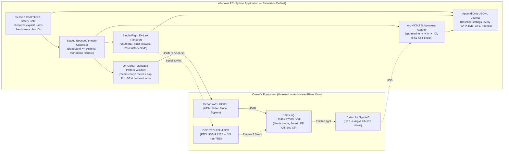

| Field | Value |
|---|---|
| Title | TV-side auto-calibration of the Samsung UE49KS7000UXXU: independent feasibility study |
| Produced by | AI: Antigravity (Google) |
| Original date | 2026-10-26 |
| Imported | 2026-10-26, by Antigravity (Google) |
| How obtained | Authored directly in this pull request on branch `antigravity/feasibility-study` in response to the owner's independent feasibility study assignment |
| Fidelity | Verbatim original report |
| Ledger ID | S-024 |

# TV-Side Auto-Calibration of the Samsung UE49KS7000UXXU: Independent Feasibility Study

> **Important status notice (read first):**
> - **Equipment test status:** **Nothing in this study has been tested on the owner's equipment.** Every hardware behaviour discussed below is **Not tested** unless and until the owner explicitly authorises a written test plan under [AGENTS.md section 7](../../AGENTS.md#7-equipment-safety-rule-6).
> - **Research boundaries respected:** No commands were sent to the TV or Denon receiver, no serial or USB instrument ports were opened, no ArgyllCMS binaries were installed or executed, no test patterns were displayed, no service menu was entered, and no home network scan was performed. All source-code and protocol checks were strictly software-only.
> - **Provenance vs equipment proof:** Primary documentation and source code establish what tools and published worksheets specify; they do **not** prove how the owner's `UE49KS7000UXXU` firmware, `SH-U35B` cable, `Spyder5`, PC or `AVC-X3800H` behave in practice.

---

## 1. Plain-English Verdict

The project asks whether we can build a **free, open-source Windows Python application** that automatically calibrates the **television's own picture settings** over **Samsung Ex-Link** (serial cable control, [D-006](../../LEDGER.md#3-decisions)), following the owner's required loop ([D-013](../../LEDGER.md#3-decisions)):

**Display a known colour patch → measure it with the Spyder5 → calculate an adjustment → change a TV picture setting through Ex-Link → exit the TV menu → wait for the picture to settle → measure again**

with **SDR Rec.709, D65 white and BT.1886 gamma** as first priority ([D-001](../../LEDGER.md#3-decisions)), and within a **£25.00 total hardware budget** (£15.99 spent, **£9.01 remaining**, [C-008](../../LEDGER.md#2-claims)).

Because **automatic operation** and **measurement accuracy** depend on different physical bottlenecks, they require separate verdicts using the four-level scale (`feasible`, `conditionally feasible`, `blocked pending evidence/testing`, `infeasible under the present constraints`):

| Objective | Verdict | Plain-English reason |
|---|---|---|
| **1. Automatic closed-loop TV-side operation over Ex-Link** | **Blocked pending evidence/testing** *(conditionally feasible only if Stage 1 check [T-001](../../LEDGER.md#5-outstanding-tests) and Stage 4 serial test [T-006](../../LEDGER.md#5-outstanding-tests) pass)* | We can build the Python software, ArgyllCMS wrapper, test-pattern window and numerical optimiser for £0 using free open-source libraries. **However, no exact-model primary source proves that the UK `UE49KS7000UXXU` exposes a working 3.5 mm Ex-Link port or accepts public consumer picture-calibration commands on its firmware without service-menu changes.** Samsung's official UK `UE49KS7000U` User Manual and UK e-Manual omit any mention of `Ex-Link` or `RS-232` ([S-025](../../LEDGER.md#1-sources), [C-062](../../LEDGER.md#2-claims)), and Portrait Displays' archived 2016 SUHD guide ([S-027](../../LEDGER.md#1-sources), [C-065](../../LEDGER.md#2-claims)) relies on Samsung's proprietary **"Samsung DDC"** calibration interface (pointing to an `"External Sync"` jack on full One Connect boxes, whereas the UK `UE49KS7000U` ships with a **One Connect Mini** that lacks a 3.5 mm socket). Until you visually check behind the TV's rear `Cover Terminal` ([T-001](../../LEDGER.md#5-outstanding-tests)) and authorise a minimal serial test ([T-006](../../LEDGER.md#5-outstanding-tests)), automatic TV-side control is **unproven**. |
| **2. Achievable SDR accuracy — relative improvement using the TV's own controls** | **Conditionally feasible** *(subject to Ex-Link control working and owner acceptance of an unvalidated quantum-dot spectral correction under [Q-016](../../LEDGER.md#6-open-questions))* | **If** Ex-Link controls work, closed-loop optimisation with the `Spyder5` can realistically make mid-to-bright greys (`20%–100%` brightness) much more neutral (removing visible colour casts relative to the chosen correction), align mid-tone gamma closer to `BT.1886`, and pull oversaturated wide-gamut colours closer to `Rec.709` using 2-point White Balance, Gamma and `Colour Space: Custom`. This relies on passing uppercase `-Y n` to ArgyllCMS `spotread` to avoid a newly identified refresh-calibration exit bug in C source code ([C-068](../../LEDGER.md#2-claims)) and on skipping `10p White Balance` if a single-step probe confirms HDTVTest's finding that UK `UE49KS7000` 10-point controls are mis-mapped ([C-073](../../LEDGER.md#2-claims)). |
| **3. Achievable SDR accuracy — independently demonstrated ("validated") absolute reference accuracy and near-black calibration** | **Infeasible under the present constraints** *(without access to an external reference spectrophotometer; [Q-001](../../LEDGER.md#6-open-questions), [Q-016](../../LEDGER.md#6-open-questions))* | Two hard physical limits of the existing `Spyder5` cannot be solved in software or within £9.01: **(a)** No `2016 Samsung SUHD` spectral sample (`.ccss`) exists in ArgyllCMS or DisplayCAL ([C-070](../../LEDGER.md#2-claims)), and a borrowed `2018 Q9 QLED` `.ccss` corrects neither the spectral difference between 2016 and 2018 quantum dots nor individual `Spyder5` filter ageing; without a reference spectrophotometer, absolute `D65` error of roughly $\Delta E_{00} \approx 1.5\text{–}4.0+$ cannot be independently measured or ruled out. **(b)** Published `Spyder5` benchmarks place its low-light floor at **`0.38 cd/m²`** ([S-031](../../LEDGER.md#1-sources), [C-072](../../LEDGER.md#2-claims)), nearly ten times brighter than this panel's `~0.04 cd/m²` native black, making true black-level and `<10%` near-black `BT.1886` measurement impossible with this meter. |

### Bottom line in one paragraph

Do **not** write the full calibration application yet, and do **not** buy any more hardware. The shortest path to proving or disproving feasibility starts with **one zero-risk, look-only check by the owner** ([T-001](../../LEDGER.md#5-outstanding-tests)): inspect the recessed port bay behind the removable `Cover Terminal` panel on the back of the `UE49KS7000UXXU` (and the One Connect Mini) for a 3.5 mm socket labelled `EX-LINK`, `EXT (RGB)`, `RS-232C` or `External Sync`, and note the TV firmware version and picture-menu options. If a 3.5 mm Ex-Link socket is present, a single short, owner-authorised serial test ([T-006](../../LEDGER.md#5-outstanding-tests)) using the already-purchased DSD TECH cable will settle whether closed-loop TV control is real or blocked under [D-006](../../LEDGER.md#3-decisions).

---

## 2. Decisive Dependency Table

Every material conclusion below separates **provenance** (who or what states it), **applicability** (exact model/firmware vs related/generic), and **equipment test status** (tested on the owner's equipment vs not tested). Technical terms are explained in plain English in Sections 3–5 and in the [workflow glossary](../workflow.md).

| # | Requirement | Evidence (Provenance · Applicability · Equipment test status) | Key uncertainty | Current status | Next decisive check |
|---|---|---|---|---|---|
| **A1** | **Physical Ex-Link socket on `UE49KS7000UXXU`** | **Primary:** Samsung UK User Manual `BN68-07864G-00` pp. 5, 8–12 & UK e-Manual `ENG-JZDVBEUK-1.1.3` ([S-025](../../LEDGER.md#1-sources), [C-062](../../LEDGER.md#2-claims)) · *Exact model (`UE49KS7000U`)* · **Not tested**. **Secondary:** Portrait archived 2016 SUHD guide ([S-027](../../LEDGER.md#1-sources)) & `S-002` citations ([C-036](../../LEDGER.md#2-claims)) · *Related 2016 SUHD models* · **Not tested**. | UK manuals omit `Ex-Link` altogether; they show `HDMI`/`USB`/`Optical` on the **One Connect Mini** (no 3.5 mm jack) and `LAN`/`CI` behind the TV's rear `Cover Terminal`. US `UN..KS8000` (regional counterpart to UK `KS7000`) lacks the EU `CI` card slot, so rear mainboard connectors may differ. | **Blocked pending owner check** | **[T-001](../../LEDGER.md#5-outstanding-tests)** (owner look-only inspection of rear `Cover Terminal` bay and One Connect Mini; no cable plugged in). |
| **A2** | **Electrical compatibility & pinout of purchased DSD TECH cable ([C-008](../../LEDGER.md#2-claims))** | **Primary (cable):** DSD TECH `SH-U35B` User Guide ([S-026](../../LEDGER.md#1-sources), [C-064](../../LEDGER.md#2-claims)) · *Exact cable model family* · **Not tested**. **Primary (TV generic):** Samsung RS-232 Worksheet p. 2 ([S-015](../../LEDGER.md#1-sources), [C-021](../../LEDGER.md#2-claims)) · *Generic consumer TV* · **Not tested**. | `S-026` confirms true RS-232 (FTDI `FT232RL`/`FT232RNL` + RS-232 transceiver, **not** 3.3 V/5 V TTL) and 3.5 mm TRS wiring **Tip = PC RX, Ring = PC TX, Sleeve = GND**, matching `S-015` p. 2 (`DB9 pin 2 → Tip, pin 3 → Ring, pin 5 → Sleeve`). Exact voltage swing is unstated in `S-026`, TV port electrical spec is unpublished for UK `KS7000`, and the delivered cable's printed model code is uninspected. | **Plausible on paper; Not tested** | **[T-001](../../LEDGER.md#5-outstanding-tests)** (read printed model label on cable) → **[T-006](../../LEDGER.md#5-outstanding-tests)** Step 1–2 (authorised USB enumeration + passive listen before TX). |
| **A3** | **Basic serial framing, UART mode & `03 0C F1` acknowledgement** | **Primary:** `S-015` pp. 1–3 ([C-057](../../LEDGER.md#2-claims), [C-066](../../LEDGER.md#2-claims)); **Primary for code / Secondary for TV:** `samsung-exlink` ([S-007](../../LEDGER.md#1-sources), [C-009](../../LEDGER.md#2-claims), [C-010](../../LEDGER.md#2-claims)) and SamyGO posts ([S-028](../../LEDGER.md#1-sources)) · *Generic / related 2016 `KS7000`* · **Not tested**. | `9600 8N1`, 7-byte frame `08 22 <cmd1> <cmd2> <cmd3> <val> <chk>` (`chk = (-sum) mod 256`), 3-byte `03 0C F1` ACK / `03 0C FF` NACK. SamyGO `p=107013` proves a 2016 `KS7000` has `RS-232 Jack: UART | Debug | Logic` (and `S-015` p. 1 shows `UART` as default), but whether the owner's set defaults to `UART` without service-menu entry ([X-002](../../LEDGER.md#4-disagreements)) is unknown. | **Unverified on owner's firmware; Not tested** | **[T-009](../../LEDGER.md#5-outstanding-tests)** (software-only codec/safety test) → **[T-006](../../LEDGER.md#5-outstanding-tests)** Step 3 (benign command check with **no** service-menu entry). |
| **A4** | **Ordinary remote-key commands (`KEY_EXIT` for [D-013](../../LEDGER.md#3-decisions))** | **Primary:** `S-015` pp. 4–5 (`cmd1=0x0d, cmd2=0x00, cmd3=0x00`, `KEY_EXIT=0x2d` → `08 22 0d 00 00 2d 9c`) · *Generic consumer TV* · **Not tested**. | `S-015` p. 5's `0x0e 0x01` is `Enable/Disable Cmd Result OSD` (command-feedback banner), **not** a user-menu dismissal command ([C-066](../../LEDGER.md#2-claims)). Whether `08 22` direct picture setters draw an on-screen slider on `T-JZMDEUC` and whether `KEY_EXIT` cleanly dismisses it without side effects must be observed on hardware. | **Not tested** | **[T-006](../../LEDGER.md#5-outstanding-tests)** Step 4 (verify `KEY_EXIT` closes an open user menu cleanly). |
| **A5** | **Direct Ex-Link access to calibration controls, encodings, persistence & restoration** | **Primary:** `S-015` p. 4 ([C-057](../../LEDGER.md#2-claims), [C-060](../../LEDGER.md#2-claims)); **Secondary:** Archived Portrait 2016 SUHD guide ([S-027](../../LEDGER.md#1-sources), [C-065](../../LEDGER.md#2-claims)) & `phillipsnick/samsung-tv` ([S-028](../../LEDGER.md#1-sources), [C-067](../../LEDGER.md#2-claims)) · *Generic / later 2020+ vs 2016 proprietary DDC* · **Not tested**. | **Highest technical risk.** Portrait (`S-027`) used Samsung's proprietary **"Samsung DDC"** protocol (with `Full DDC Reset` and `Expert Mode` toggle workarounds), **not** public `08 22` picture commands. `S-015` reflects later 2020+ menu naming (`Brightness 0~50`, `Shadow Detail -5~+5`), leaves signed `-50..+50` / `-3..+3` wire encoding unspecified, has a `10p WB Reset` byte anomaly (`0x00 0x1b` vs `0x07 0x1b`), uses stateful selector+value pairs for `10p WB` and `CMS`, and offers **zero setting readback**. | **Blocked pending hardware test ([Q-006](../../LEDGER.md#6-open-questions))** | **[T-006](../../LEDGER.md#5-outstanding-tests)** Step 5 (test one reversible unsigned control, then signed `2p WB`, `Gamma` and `CMS` encodings in `Movie` mode; verify persistence and manual restoration). |
| **B1** | **Programmatic `Spyder5` readings via ArgyllCMS on Windows** | **Primary:** ArgyllCMS V3.5.0 docs & C source `spectro/spotread.c`, `spectro/spyd2.c` ([S-014](../../LEDGER.md#1-sources), [S-029](../../LEDGER.md#1-sources), [C-055](../../LEDGER.md#2-claims), [C-056](../../LEDGER.md#2-claims), [C-068](../../LEDGER.md#2-claims), [C-069](../../LEDGER.md#2-claims)) · *Exact meter (`Spyder5`, `hwver == 10`)* · **Not tested**. | Requires ArgyllCMS LibUSB/WinUSB driver (conflicts with Datacolor software and RGB-lighting services). **Critical C-source bug caught:** QLED `.ccss` files set `DISPLAY_TYPE_REFRESH "YES"`, causing `spotread -O` without uppercase `-Y n` to calibrate refresh rate and exit with **zero XYZ readings** (`-y n` is overwritten by `-X`, and `-N` is unsupported on Spyder5; [C-068](../../LEDGER.md#2-claims)). Spyder5 also lacks USB hardware reset (`spyd2.c` `L2973`; [C-069](../../LEDGER.md#2-claims)). | **Supported in primary code; Not tested on owner's PC** | **[T-003](../../LEDGER.md#5-outstanding-tests)** (authorised driver check, `spotread -e -x -Y n -O` repeatability, dark-floor and timeout safety test). |
| **B2** | **Spectral correction (`.ccss` / `.ccmx`) & low-light floor on 2016 SUHD quantum dots** | **Primary:** ArgyllCMS `spyd2.c` `L3126, L3207–3238, L3687–3773` & DisplayCAL CCSS database ([S-029](../../LEDGER.md#1-sources), [C-070](../../LEDGER.md#2-claims)); **Secondary:** ChromaPure/CurtPalme benchmark & HDTVTest `UE49KS7000` review ([S-031](../../LEDGER.md#1-sources), [C-072](../../LEDGER.md#2-claims)) · *Exact meter; proxy 2018 QLED display* · **Not tested**. | Zero `2016 SUHD`/`KS7000`/`KS8000` `.ccss` files exist in DisplayCAL or ArgyllCMS; Datacolor's OEM modes (`f, L, e, B, x`) omit quantum-dot LED. DisplayCAL's `Samsung Q9` (2018) `.ccss` is an unvalidated proxy and cannot fix unit-specific `Spyder5` filter drift. Low-light floor is **`0.38 cd/m²`** vs `~0.04 cd/m²` TV black ([C-072](../../LEDGER.md#2-claims)). Standard `spotread` XYZ cannot be retroactively re-scored with a new CCSS ([C-070](../../LEDGER.md#2-claims)). | **Relative calibration viable; validated absolute accuracy blocked ([Q-001](../../LEDGER.md#6-open-questions), [Q-016](../../LEDGER.md#6-open-questions))** | **Owner decision [Q-016](../../LEDGER.md#6-open-questions)** + **[T-004](../../LEDGER.md#5-outstanding-tests)** (compare candidate `.ccss` files and lock metadata/hashes per run). |
| **C1** | **Unaltered Windows → GPU → Denon `AVC-X3800H` → TV test-patch signal path & [D-013](../../LEDGER.md#3-decisions) settle delay** | **Primary:** Microsoft Learn ACM ([S-017](../../LEDGER.md#1-sources), [C-059](../../LEDGER.md#2-claims)), ArgyllCMS `dispwin` ([S-029](../../LEDGER.md#1-sources)), Denon `AVC-X3800H` manual ([S-030](../../LEDGER.md#1-sources), [C-071](../../LEDGER.md#2-claims)), Samsung UK e-Manual ([S-025](../../LEDGER.md#1-sources), [C-063](../../LEDGER.md#2-claims)) · *Exact receiver & TV manuals; PC unknown* · **Not tested**. | Denon `Video Mode: Bypass` disables receiver video processing and OSD overlays ([C-071](../../LEDGER.md#2-claims)), and UK e-Manual confirms `PC` input icon / `Game` mode lock out `White Balance`, `Gamma` and `Colour Space` ([C-063](../../LEDGER.md#2-claims)). Windows ACM, HDR, Night Light, GPU LUTs and HDMI range mismatches can alter patches; optical/visual checks (`T-005`) catch range/LUT errors but cannot prove bit-exact HDMI codes ([X-008](../../LEDGER.md#4-disagreements)). Settle delay ([Q-008](../../LEDGER.md#6-open-questions)) is unmeasured. | **Configurable for £0; PC path unknown ([T-002](../../LEDGER.md#5-outstanding-tests)); Not tested** | **[T-002](../../LEDGER.md#5-outstanding-tests)** (owner connection/settings check) → **[T-005](../../LEDGER.md#5-outstanding-tests)** (visual + meter range/LUT check) & **[T-006](../../LEDGER.md#5-outstanding-tests)**/`T-013` step-response timing for **[Q-008](../../LEDGER.md#6-open-questions)**. |
| **D1** | **Reliable discrete optimiser, `10p WB` safety, rollback & FOSS Windows packaging** | **Primary:** ITU-R BT.1886 ([S-016](../../LEDGER.md#1-sources), [C-058](../../LEDGER.md#2-claims)), ArgyllCMS AGPLv3 & DisplayCAL GPLv3 licences ([S-029](../../LEDGER.md#1-sources)); **Secondary:** HDTVTest UK `UE49KS7000` review ([S-031](../../LEDGER.md#1-sources), [C-073](../../LEDGER.md#2-claims)) · *Exact UK TV model review; software design* · **Not tested**. | HDTVTest found `10p White Balance` on its UK `UE49KS7000` sample was "contrast-aligned" and caused unwanted luminance shifts ([C-073](../../LEDGER.md#2-claims)), so blind 10-point optimisation could degrade the picture. Lack of Ex-Link readback requires owner-recorded baseline menus, bounded coordinate steps above meter noise, monotonic rollback, and disjoint verification patches. ArgyllCMS's **AGPLv3** licence requires keeping it an external user-installed CLI tool. | **Feasible in software once A5 & B1 pass; Not tested** | **Software simulation suite** → **[T-013](../../LEDGER.md#5-outstanding-tests)** (one-control reversible closed-loop test) → **[T-008](../../LEDGER.md#5-outstanding-tests)** (staged SDR calibration). |

---

## 3. Independent Comparison with Earlier Research

Three earlier AI research documents exist in the repository (`S-002` by Claude/Anthropic, `S-012` by ChatGPT/OpenAI, and `S-005` plus `C-055`–`C-061` by Codex/OpenAI). The separate ChatGPT critique (`S-003`) has not yet been supplied to the repository and was not accessible; no view is attributed to `S-003`. Under [AGENTS.md section 6](../../AGENTS.md#6-evidence-provenance-and-citations-rules-3-and-5), agreement between AI systems is **not** evidence. Below is where independent primary-source checks support, correct or disagree with each earlier document.

### 3.1 Comparison with the Claude feasibility report (`S-002`, Anthropic, 23 October 2026)

- **Where primary sources support `S-002`:**
  - **Ex-Link electrical pinout and checksum rule:** `S-015` p. 2 confirms `08 22` 7-byte framing, two's-complement modulo-256 checksum, and `Tip = PC RX (DB9 pin 2), Ring = PC TX (DB9 pin 3), Sleeve = GND (DB9 pin 5)`.
  - **ArgyllCMS Spyder5 CCSS support and Windows USB driver requirements:** Confirmed by `S-014` (`instruments.html`, `Installing_MSWindows.html`) and `spyd2.c` `L3207–3238, L3545–3547` (`inst2_ccss`).
  - **Absence of a 2016 SUHD CCSS and high Spyder5 low-light floor:** Confirmed by querying DisplayCAL's live correction database (`S-029`, [C-070](../../LEDGER.md#2-claims)) and CurtPalme/ChromaPure's Spyder5 test data (`0.38 cd/m²`, `S-031`, [C-072](../../LEDGER.md#2-claims)).
  - **Denon `Video Mode: Bypass` and UK `UE49KS7000` 10-point white-balance caution:** Confirmed directly in the Denon `AVC-X3800H` manual (`S-030`, [C-071](../../LEDGER.md#2-claims)) and HDTVTest's UK `UE49KS7000` review (`S-031`, [C-073](../../LEDGER.md#2-claims)).
- **Where `S-002` overstated evidence or contained technical errors uncovered by primary-source inspection (recorded in [X-010](../../LEDGER.md#4-disagreements) and [C-062](../../LEDGER.md#2-claims)–[C-070](../../LEDGER.md#2-claims)):**
  1. **Unconditional "Feasible" headline verdict (`S-002` section 1) vs unproven Ex-Link control:** `S-002` relied on WebSocket remote-key navigation as a "guaranteed £0 floor" (`C-051`, now out of scope under [D-006](../../LEDGER.md#3-decisions)) and treated Portrait Displays' 2016 SUHD guide (`C-035`) as proof that consumer Ex-Link calibration works seamlessly. Under Ex-Link-only scope (`D-006`), feasibility is **blocked pending evidence/testing**, not established ([X-010](../../LEDGER.md#4-disagreements)).
  2. **Conflation of Portrait's proprietary "Samsung DDC" protocol with public `08 22` consumer commands (`C-035` vs `S-027`, [C-065](../../LEDGER.md#2-claims)):** Retrieving the archived Portrait guide (`S-027`) shows CalMAN uses Samsung's proprietary **DDC** serial subsystem (`Full DDC Reset`, `Expert Mode` toggle, `Cal Day`/`Cal Night` modes, 20-point greyscale), **not** verified public `08 22` consumer picture frames (`S-015`). Furthermore, `S-027` instructs users to plug into `"External Sync"` on the side of a full One Connect box — whereas the UK `UE49KS7000U` uses a **One Connect Mini** with no 3.5 mm port (`S-025`, [C-062](../../LEDGER.md#2-claims)).
  3. **Broken `spotread` command flags (`S-002` section 5 line 230 vs `spotread.c` & `spyd2.c`, [C-068](../../LEDGER.md#2-claims)):** `S-002` advised combining `spotread -O` with `-N (skip calibration), -x, -X file.ccss and -y n (non-refresh, for LCD)`. Inspection of ArgyllCMS V3.5.0 C source (`S-029`) shows three interacting bugs in that exact command: (i) lowercase `-y` selects an instrument display-type slot (`spotread.c` `L726`), whereas non-refresh override is **uppercase `-Y n`** (`L1063, L1078`); (ii) `-X <QLED.ccss>` subsequently calls `spyd2_col_cal_spec_set()` (`spyd2.c` `L3235`), overwriting `-y`'s refresh flag with `DISPLAY_TYPE_REFRESH "YES"` (`refr = 1`) present in every DisplayCAL Samsung QLED `.ccss`; and (iii) `-N` (`inst_opt_noinitcalib`) is **not supported** by the Spyder driver (`spyd2.c` `L3958–4093`). As a result, `S-002`'s command performs only an 80%-white refresh calibration and exits at `if (doone) break;` (`spotread.c` `L2150`) with **zero XYZ readings**.
  4. **False claim that saved `spotread` readings can be retroactively re-scored with a new CCSS (`S-002` section 5 line 212 vs `spyd2.c` `L3126`, [C-070](../../LEDGER.md#2-claims)):** The Spyder5 returns 3-channel tristimulus values (not 380–730 nm spectra), and `spyd2.c` multiplies sensor output by the active $3\times 3$ calibration matrix `p->ccmat` inside `spyd2_read_sample` (`L3126`) before `spotread` prints or logs `XYZ`. Changing `.ccss` requires either re-measuring on hardware or recording the exact original `ccmat` (via `-D4` debug output) and inverting it mathematically — standard `spotread` logs alone cannot be re-scored.
  5. **Misinterpretation of `S-015` p. 5's OSD command (`C-038` vs `S-015` p. 5, [C-066](../../LEDGER.md#2-claims)):** `0x0e 0x01` is titled `Enable/Disable Cmd Result OSD` (controlling feedback banners), not a general user-menu suppression command; `KEY_EXIT` (`08 22 0d 00 00 2d 9c`) remains required for [D-013](../../LEDGER.md#3-decisions).
  6. **Uncritical citation of `phillipsnick/samsung-tv` (`C-037` vs `S-028`, [C-067](../../LEDGER.md#2-claims)):** Inspecting `phillipsnick/samsung-tv/lib/app.js` (`L30–38`) shows its checksum implementation adds `0x08 + 0x22 + ...` directly instead of computing two's-complement `(-sum) & 0xFF`, producing invalid frames for every command, and implements zero white-balance or CMS commands.
  7. **"Menu-open reading" shortcut (`C-049`):** Already superseded by owner decision [D-013](../../LEDGER.md#3-decisions) (`change → exit → wait → read`).
  8. **Unverified owner GPU assumption (`C-045`):** `S-002` designed around an `NVIDIA GTX 1080` and `GeForce Now` not confirmed by the owner in this repository; `T-002` must establish the actual PC/GPU hardware first.

### 3.2 Comparison with the original ChatGPT feasibility research (`S-012`, OpenAI, 23 October 2026)

- **Where independent analysis agrees with `S-012`:**
  - Separating **repeatability / closed-loop convergence** from **absolute accuracy** (`C-028`), warning that another unit's `.ccmx` does not calibrate the owner's `Spyder5`, highlighting Windows/GPU/HDMI range hazards (`C-030`), and recommending a **single-control reversible luminance feedback test** (`C-031` / `T-013`) before attempting multi-control greyscale or CMS optimisation.
- **Where `S-012` is superseded, unverified or incomplete:**
  - All 18 `:chatgpt-content-reference` markers in `S-012` remain unresolved, and its claimed `sandbox:` diagnostic kit passing 15 offline tests (`C-025`) is inaccessible and unverified.
  - Its network-control (`samsungctl` / WebSocket) first-experiment recommendation and "do not buy a cable yet" advice (`C-034`) are superseded by [D-006](../../LEDGER.md#3-decisions) (Ex-Link only) and [C-008](../../LEDGER.md#2-claims) (£15.99 cable already purchased).
  - Like `C-041`, `S-012` missed the `spotread -O` + QLED `.ccss` refresh-calibration trap ([C-068](../../LEDGER.md#2-claims)).

### 3.3 Comparison with Codex's protocol investigation and source checks (`S-005` & `C-055`–`C-061`, OpenAI, 24–25 October 2026)

- **Strong alignment on methodology and protocol rigour:**
  - Independent verification confirms Codex's checksum arithmetic (`S-005`), the `mgoff/go-samsung-exlink` `0xD6` vs `0xD4` bug (`X-001`), the weakness of an 8-bit additive checksum against byte transpositions (`C-013`), the strict separation of `03 0C F1` acknowledgement from stored menu state and measured light (`X-005`), the refusal to resend blindly after an ambiguous serial timeout (`X-007`), and the distinction between optical range checks and true bit-exact HDMI verification (`X-008`).
- **New primary evidence added beyond `S-005` / `C-055`–`C-061`:**
  - **Binary identity of `S-015` and `S-006` ([C-066](../../LEDGER.md#2-claims)):** Codex left open (`C-052` note, `S-015`) whether Samsung's hosted `Samsung-RS232-Control.pdf` matches the community mirror `S-006`. Downloading `S-015` (`509,710` bytes) yields SHA-256 `38b932a0a712815f845c509ca77b8ea470b703425a598ac905a9d4998d4657fb` — **byte-for-byte identical** to `S-006` (`C-060`). Thus `S-006`, `S-007` and `S-015` are **one single upstream source**, not independent confirmations.
  - **Resolution of missing sources:** Consulted the official UK `UE49KS7000UXXU` manuals (`S-025`, previously inaccessible in `C-011`), DSD TECH's `SH-U35B` cable datasheet (`S-026`), the Wayback-archived Portrait `2016 SUHD` guide (`S-027`, previously unretrievable in `Q-006`), SamyGO threads (`S-028`), ArgyllCMS V3.5.0 C source (`S-029`), and Denon's `AVC-X3800H` manual (`S-030`).

---

## 4. Realistic Accuracy Assessment (Dependency 4B & Target Standards)

### 4.1 Exact-model display characteristics (`Samsung UE49KS7000UXXU`)
- **Panel & backlight:** 49-inch 10-bit VA LCD panel (`3840 × 2160`) with an edge-lit blue-LED + Indium Phosphide (InP, cadmium-free) **quantum-dot enhancement film** ("SUHD" / narrow-band green and red emission peaks), native ANSI black `~0.04 cd/m²` at `120 cd/m²` peak white (`~3,000:1` native contrast), and 10-column edge local dimming (`Smart LED`; [S-031](../../LEDGER.md#1-sources)).
- **UK vs US naming & limits:** HDTVTest (`S-031`) confirms the UK/European `UE..KS7000` is the regional counterpart of the North American `UN..KS8000` (whereas the UK also had a separate step-up `UE..KS8000`). While panel optics are comparable, **hardware ports and firmware (`T-JZMDEUC` in EU vs `T-JZMAKUC` in US) are not interchangeable**: European models include a DVB Common Interface (`CI`) slot behind the rear `Cover Terminal` (`S-025` p. 11), UK HDTVTest observed `10p White Balance` (mis-aligned to contrast) whereas US RTINGS/Portrait text mentions `20p`, and UK `UE49KS7000U` manuals omit `Ex-Link` (`C-062`).

### 4.2 Why narrow-band quantum dots challenge the `Spyder5`
A tristimulus colorimeter (`Spyder5`) does not measure wavelengths; it views light through three broadband organic RGB filters whose spectral sensitivities imperfectly match human CIE $1931\ 2^\circ$ $\bar{x}(\lambda), \bar{y}(\lambda), \bar{z}(\lambda)$ curves. On narrow-band quantum-dot red (`~630 nm`) and green (`~530 nm`) spikes, small filter-slope errors produce large systematic shifts in measured $(x, y)$ unless compensated:
1. **Built-in OEM calibrations (`oeminst`) are insufficient:** `spyd2.c` (`L3687–3773`, [C-070](../../LEDGER.md#2-claims)) shows that even if `oeminst` extracts Datacolor's proprietary setup data, the `Spyder5` (`hwver == 10`) shares the `Spyder4`'s static 7-slot table covering only generic non-refresh LCD (`nl`), CRT (`rc`), CCFL (`f`, `L`, `x`), standard White LED (`e`), and RGB LED (`B`) — **no quantum-dot display type exists**.
2. **Borrowed `.ccss` vs pair-specific `.ccmx`:**
   - A **`.ccss` (Colorimeter Calibration Spectral Sample)** file stores red, green, blue and white spectral power distributions measured on a sample TV. ArgyllCMS integrates those spectra against the *factory-stored* spectral sensitivity curves inside the `Spyder5` EEPROM (`spyd2.c` `L3229`, `inst2_ccss`) to compute a $3\times 3$ matrix.
   - **Two uncompensated error sources remain with any borrowed `.ccss`:**
     1. *Display spectrum mismatch:* Querying DisplayCAL's live database (`S-029`, [C-070](../../LEDGER.md#2-claims)) across Samsung (`SAM`/`SEC`) confirms **zero `2016 SUHD` (`KS7000`/`KS8000`/`KS9000`) `.ccss` files exist**. The closest community files are `Samsung Q9 75" (i1 Pro)` (2018 QLED) and `Samsung QLED Q80D` (2024). Between 2016 SUHD and 2018 QLED, Samsung modified its quantum-dot formulation to widen colour volume.
     2. *Individual meter filter ageing:* A `.ccss` trusts the `Spyder5`'s factory EEPROM filter curves from ~2015–2018. Organic gel/dye filters in Spyder-series meters drift with age and humidity; only a **pair-specific `.ccmx`** (a $3\times 3$ matrix measured simultaneously with *this exact Spyder5* and a *reference spectrophotometer* on *this exact TV*) cancels both display-spectrum mismatch and unit-specific filter drift.

### 4.3 Low-light floor, repeatability, and `BT.1886` near-black limits
- **Low-light floor (`0.38 cd/m²`):** ChromaPure's direct benchmark of the `Spyder5` against a `CR-300`-referenced `CR-100` (`S-031`, [C-072](../../LEDGER.md#2-claims)) found a minimum usable luminance limit of **`0.38 cd/m²`** and a sweep time of **`231 s` for 95 patches** (`~2.4 s` average, much slower near dark).
- **Consequence for `BT.1886` ([S-016](../../LEDGER.md#1-sources), [C-058](../../LEDGER.md#2-claims)):** Under ITU-R BT.1886 Annex 1:
  $$L(V) = a \cdot \max(V + b, 0)^{2.4}, \qquad b = \frac{L_B^{1/2.4}}{L_W^{1/2.4} - L_B^{1/2.4}}, \qquad a = \left(L_W^{1/2.4} - L_B^{1/2.4}\right)^{2.4}$$
  With $L_W = 120\text{ cd/m}^2$ and typical native VA black $L_B \approx 0.04\text{ cd/m}^2$:
  - `0%` black (`0.04 cd/m²`) is **9.5× darker** than the `Spyder5`'s `0.38 cd/m²` floor;
  - `5%` stimulus (`~0.18 cd/m²`) is **below** the floor;
  - `10%` stimulus (`~0.61 cd/m²`) sits barely above the floor with high chromaticity noise (ChromaPure recorded `0.015` greyscale $x$ error when `5%` was included);
  - `20%` stimulus (`~2.45 cd/m²`) and above sit comfortably in the `Spyder5`'s reliable regime, where ChromaPure measured `~0.005–0.006` $(x, y)$ error (`~1.3–2.5` $\Delta E_{00}$ with a matched correction).

### 4.4 What can vs cannot be validated with the owner's equipment
| Capability | Can we validate it with owned equipment alone? | Why, and honest accuracy ceiling |
|---|---|---|
| **Meter repeatability ($\sigma_Y, \sigma_x, \sigma_y$) & warm-up drift** | **Yes** (in authorised [T-003](../../LEDGER.md#5-outstanding-tests)) | Repeated readings on a static patch measure precision directly without a reference meter. |
| **Greyscale neutrality / smoothness (`20%–100%`)** | **Yes, in relative terms** | Because `20%–100%` greys on an LCD use the same backlight spectrum scaled in intensity, `Spyder5` channel ratios track *inter-step* greyscale casts well even with an approximate `.ccss`. Optimising 2-point White Balance (`20%–25%` Offset, `80%` Gain) can flatten visible green/magenta/blue casts across mid-to-bright tones. |
| **Mid/high-tone `BT.1886` gamma curve (`20%–100%`)** | **Yes, subject to an explicit black-level assumption** | Relative luminance $Y(V)/Y(100\%)$ is insensitive to small chromaticity errors. Below `15%–20%`, `Brightness` must be set visually on a PLUGE pattern, and $L_B$ in BT.1886 must be explicitly labelled as an **unverified assumed parameter** (e.g. $L_B = 0$ pure $2.4$ power law or an owner-chosen ratio under [Q-014](../../LEDGER.md#6-open-questions) — at `20%` stimulus, $L_B = 0$ vs $L_B = 0.04\text{ cd/m}^2$ at $120\text{ cd/m}^2$ differs by $<0.12\text{ cd/m}^2$). |
| **Taming wide-gamut oversaturation toward `Rec.709`** | **Substantial relative improvement** | Uncalibrated `Native` gamut on this quantum-dot panel heavily oversaturates `Rec.709` reds and greens. Switching to `Auto` or tuning `Custom` CMS at `75%` stimulus/saturation brings colours much closer to `Rec.709` than uncalibrated wide gamut, bounded by meter error ($\Delta E_{00} \approx 2\text{–}4$). |
| **True absolute `D65` white point & certified $\Delta E_{00} < 1.5$** | **No** ([Q-001](../../LEDGER.md#6-open-questions), [Q-016](../../LEDGER.md#6-open-questions)) | Self-referenced readings ("the `Spyder5` reports $\Delta E_{00} = 0.6$ using the same `Spyder5` that guided the optimiser") prove **optimiser convergence**, **not** true absolute accuracy. Without borrowing a spectrophotometer (`i1Pro 2` / `i1Studio` / `ColorMunki Photo`, ~5 nm–10 nm optical resolution) to build a pair-specific `.ccmx`, true absolute white-point error remains an **unverified systematic offset of roughly $\Delta E_{00} \approx 1.5\text{–}4.0+$** (`±200–500 K`). |

---

## 5. Proposed Architecture (Dependencies 4A, 4B, 4C, 4D)

The architecture below cleanly separates **software components we can verify offline** from **hardware hypotheses awaiting [T-001](../../LEDGER.md#5-outstanding-tests)–[T-013](../../LEDGER.md#5-outstanding-tests)**, enforces [AGENTS.md section 7](../../AGENTS.md#7-equipment-safety-rule-6) (simulation by default, explicit owner arming for real hardware, complete command logging), and preserves the owner's mandatory [D-013](../../LEDGER.md#3-decisions) cycle.

### 5.1 TV-Control Backend (`tv_autocal.exlink`) — Dependency 4A
- **Framing & single-flight state machine:** `9600` baud, `8` data bits, `No` parity, `1` stop bit, no flow control (`S-007`, `S-015`). Encodes `08 22 <cmd1> <cmd2> <cmd3> <value> <chk>` where `chk = (-sum(frame[:6])) & 0xFF`. Only **one** command may be in flight (`2.0 s` reply timeout + `1.0 s` late-reply drain window after any timeout, matching `S-007` `protocol.py`).
- **Ambiguous-outcome stop rule ([X-007](../../LEDGER.md#4-disagreements)):** On timeout, `03 0C FF` NACK, or unexpected bytes, **never auto-retry blindly**; log raw TX/RX bytes with monotonic timestamps and halt for operator inspection.
- **Hard-coded safety allowlist ([C-022](../../LEDGER.md#2-claims), [C-050](../../LEDGER.md#2-claims)):** Rejects `KEY_FACTORY` (`0x3B`), `Factory-SVB / Expert-N/D Adj` (`0x0b 0x0d`), `Reset Picture` (`0x0b 0x0b 0x00 0x00` unless explicitly requested in a recovery script), `Apply All Sources` (`0x0b 0x0e 0x00 0x00`), and any unrecognised byte tuple **before** reaching the transport layer (tested offline in `T-009`).
- **Menu-exit enforcement ([D-013](../../LEDGER.md#3-decisions)):** Every setting-change transaction executes atomically as:
  1. Send allowlisted setting command (`7` bytes) → verify `03 0C F1`;
  2. Send `KEY_EXIT` (`08 22 0d 00 00 2d 9c`) → verify `03 0C F1`;
  3. Sleep $t_{\text{wait}}$ seconds (determined empirically in `T-006`/`T-013` for [Q-008](../../LEDGER.md#6-open-questions));
  4. Render target patch (plus $t_{\text{patch}}$ settle if patch changed) → trigger `spotread`.
- **Stateful multi-byte controls & unproven encodings (hypotheses gated on `T-006`):**
  - `10p White Balance` (`0x0b 0x07 0x17` interval selector `1..10`, followed by `0x18`/`0x19`/`0x1a` R/G/B) and `Color Space Custom` (`0x0b 0x07 0x12` colour selector `0..5`, followed by `0x13`/`0x14`/`0x15` R/G/B `0..100`) are wrapped as paired transactions so a channel write is never sent without first selecting the intended interval or colour axis.
  - Signed controls (`2p WB` `-50..+50`, `Gamma` `-3..+3`) must **not** assume two's-complement (`0xFF = -1`) vs offset-binary (`0x32 = 0`) until `T-006` tests `value = 0` and `+1` first, then checks `-1` against the TV's visible menu value.

### 5.2 ArgyllCMS Measurement Adapter (`tv_autocal.meter`) — Dependency 4B
- **Command-line invocation (fixing [C-068](../../LEDGER.md#2-claims)):**
  - Invokes user-installed `spotread.exe` via `subprocess.run(..., shell=False)` with:
    `spotread -e -x -Y n -X <correction.ccss> -O <temp_reading.log>`
  - **Why these exact flags:** `-e` selects absolute emissive mode; `-x` prints `XYZ` and CIE `Yxy`; **uppercase `-Y n`** sets `inst_mode_emis_norefresh_ovd` (`spotread.c` `L1078–1080`, `spyd2.c` `L3158`), preventing a QLED `.ccss` with `DISPLAY_TYPE_REFRESH "YES"` from triggering an 80%-white refresh-rate calibration and exiting with zero readings under `-O`; `-N` is omitted because `spyd2.c` does not implement `inst_opt_noinitcalib`.
  - **Optional persistent subprocess optimization (Phase 2):** Because opening USB comms per reading adds `~1–2 s` overhead, a later verified enhancement can keep an interactive `spotread -e -x -Y n -X <ccss>` session alive via Windows ConPTY (`pywinpty`, MIT licence), sending a single spacebar trigger per reading and `q` on clean shutdown — **never** `TerminateProcess` mid-integration, because `spyd2.c` `L2973–2990` documents that `Spyder5` has no USB reset command and may require physically replugging USB if killed mid-read ([C-069](../../LEDGER.md#2-claims)).
- **Strict output & metadata validation:** Parses both stdout (`Result is XYZ: X Y Z, Yxy: Y x y`, `spotread.c` `L2969`) and the tab-separated log file; rejects non-zero exit codes, `NaN`/`Inf`, $Y \le 0$, or missing `Result is XYZ:` lines; enforces $Y \ge 0.50\text{ cd/m}^2$ for chromaticity optimisation (`0.38 cd/m²` floor + margin); takes $N = 3$ (`\ge 30%` stimulus) to $N = 5$ (`15%–25%` stimulus) median-filtered repeats when consecutive readings exceed $2\sigma$; and records ArgyllCMS version, `.ccss` filename and SHA-256 hash in the session journal.

### 5.3 Signal Path & Test-Pattern Renderer (`tv_autocal.patterns`) — Dependency 4C
- **Pre-flight checklist & automated checks (no silent system mutation):**
  1. Clear any active GPU 1D calibration LUT via `dispwin -c` (restoring the user's previous profile on exit if desired; `S-029`).
  2. Verify Windows **HDR = Off**, **Night Light = Off**, and **Automatically manage color for apps (ACM) = Off** (`S-017`, `C-059`).
  3. Recommended HDMI transport: **1920×1080p @ 60 Hz (or 3840×2160p @ 24/30 Hz), RGB 4:4:4, 8 bpc, GPU Dynamic Range = Full (0–255)**, rendering **video-legal code values (`16–235`)** inside a borderless full-screen Direct3D/OpenGL/GDI surface (bypassing browser/ICC colour management) with TV **`HDMI Black Level = Low`** — *or* full-range `0–255` patches with TV `HDMI Black Level = Normal`, verified via `T-005` PLUGE (`14, 15, 16, 17, 18` and `233, 234, 235, 236, 237`) so Black-er-than-Black (`<16`) and White-er-than-White (`>235`) behave as expected (`X-008`). Avoiding 4K60 prevents HDMI 2.0a bandwidth fallback to `YCbCr 4:2:0` or `4:2:2`.
  4. **Denon `AVC-X3800H` settings ([S-030](../../LEDGER.md#1-sources), [C-071](../../LEDGER.md#2-claims)):** Owner sets `Video → Output Settings → Video Mode = Bypass` (disables receiver video conversion/upscaling and suppresses Denon OSD overlays over video; note `Bypass` is unavailable in `IMAX DTS` sound modes).
  5. **Samsung TV mode prerequisites ([S-025](../../LEDGER.md#1-sources), [S-031](../../LEDGER.md#1-sources), [C-063](../../LEDGER.md#2-claims)):** Input icon **not** set to `PC` / `DVI PC`, `Special Viewing Mode` (`Game` / `HDR+`) **Off**, Picture Mode **`Movie`**, `Color Tone = Warm2`, `Smart LED = Off` (during calibration so window size and full-black auto-shutoff do not modulate backlight), `Eco Sensor = Off`, `Motion Lighting = Off`, `Dynamic Contrast = Off`, `Auto Motion Plus = Off`, `Digital Clean View = Off`.
- **Patch geometry for the hanging `Spyder5` ([C-023](../../LEDGER.md#2-claims)):** Because the `~5 cm` circular `Spyder5` hangs at screen centre with its `~5 cm` counterweight cap hanging directly beneath it (`~12–15 cm` vertical span in total), a tiny 10% centre box could partially overlap the hanging cap or suffer stray surround glare. On a 49-inch screen (`108.5 × 61.0 cm`), an **`18%–25%` area central window** (`~46 × 26 cm` to `54 × 30 cm`) on a neutral black (`code 16`) background completely covers both the sensor aperture and the shadow of the cap while keeping constant thermal load (LCDs with `Smart LED = Off` have negligible APL power limiting in SDR, which `T-005` verifies by comparing `18%` vs `50%` window luminance).
- **Choosing the [D-013](../../LEDGER.md#3-decisions) settle delay empirically ([Q-008](../../LEDGER.md#6-open-questions)):** Rather than guessing `1 s` or `2 s`, `T-006`/`T-013` runs a **step-response characterization**: change `Backlight` (`10 → 16 → 10`) and a `2p WB` gain step, send `KEY_EXIT`, and log continuous `spotread` timestamps $(t_k, Y_k, x_k, y_k)$ over `10 s`. Set $t_{\text{wait}}$ to the earliest delay after which $|Y(t) - Y(\infty)| \le 2\sigma_Y$ and $\max(|x(t)-x(\infty)|, |y(t)-y(\infty)|) \le 2\sigma_{xy}$, **plus a `0.5 s` safety margin** (Portrait's generic default of `2.0 s` in `S-027` serves only as the initial conservative starting value for that test).

### 5.4 Numerical Optimiser, Verification & Safe Stopping (`tv_autocal.optimiser`) — Dependency 4D
- **Control adjustment order & decoupling:**
  1. **Manual Pre-Flight (Owner + guided checks):** Confirm baseline menu photos/values recorded in journal; check `Brightness` (near-black clipping) and `Contrast` (near-white clipping) visually on PLUGE (`Spyder5` cannot read black; leave `Brightness` and `Contrast` untouched unless clipping is seen).
  2. **Stage A — Peak Luminance (`Backlight`, integer `0..20`):** Monotonic 1D bracket + discrete secant step on `100%` white (`code 235`) to hit the owner-selected dark/dim-room target $L_W$ (e.g. `100–120 cd/m²`, [Q-014](../../LEDGER.md#6-open-questions)).
  3. **Stage B — Coarse EOTF (`Gamma` slider, integer `-3..+3`):** Evaluate the `7` discrete settings at `30%, 50%, 70%` grey and pick the integer minimising RMS log-luminance error against the target `BT.1886` curve.
  4. **Stage C — 2-Point White Balance (`R/G/B Gain` & `R/G/B Offset`, integers `-50..+50`):**
     - **Anchor green (`G-Gain = 0`, `G-Offset = 0`)** so white luminance and dynamic range are never clipped! Adjust **only two independent axes per point** (`R-Gain, B-Gain` at **`80%` grey**; `R-Offset, B-Offset` at **`20%–25%` grey** — deliberately above the noisy `5%–10%` Spyder5 zone).
     - Estimate the $2\times 2$ local Jacobian $\mathbf{J}_{\text{gain}} = \partial(u', v')/\partial(R_G, B_G)$ from symmetric $\pm 4$-tick finite differences (large enough to exceed $5\sigma_{u'v'}$), then take damped rounded integer steps $\Delta \mathbf{u} = -\text{round}(\alpha \mathbf{J}^{-1} \mathbf{e})$ ($\alpha = 0.7$, max step $\pm 8$ ticks), alternating `80%` Gain and `25%` Offset for `2–3` outer passes because Gain and Offset weakly cross-couple.
  5. **Stage D — Gated Multi-Point White Balance (`10p WB`, optional & guarded against [C-073](../../LEDGER.md#2-claims)):**
     - Only entered if post-2pt greyscale (`20%–100%`) still exceeds the convergence deadband (e.g. $\max \Delta E_{00} > 1.5$ as read by the meter).
     - **Mandatory UK `KS7000` firmware sanity probe:** Perturb interval `5` (`50%`) Green/Red by `+5`, measure `40%, 50%, 60%` grey, and immediately restore `0`. If the perturbation shifts `40%`/`60%` anomalously, alters luminance disproportionately ("contrast-aligned" bug reported by HDTVTest `S-031`), or fails to improve cost, **automatically disable `10p WB` (`08 22 0b 07 16 00 ae`) and keep the clean 2-point calibration**.
  6. **Stage E — Colour Management (`Colour Space: Custom`, 6 colours $\times$ `R, G, B` `0..100`):**
     - First measure `Colour Space: Auto` vs `Custom` (defaults) at **`75%` saturation / `75%` stimulus** Rec.709 primaries and secondaries (`R, G, B, Y, C, M`) plus `50%` saturation check patches (avoiding `100%` hull clipping).
     - For each colour $c \in \{R, G, B, Y, C, M\}$, `R/G/B` sliders mix primary light nearly linearly in CIE $XYZ$: measure a `+6`-tick finite-difference $3\times 3$ sensitivity matrix $\partial(X, Y, Z)/\partial(r_c, g_c, b_c)$ and solve a bounded integer least-squares step minimising $\Delta E_{00}(c)$ while penalising gamut-clipping or skin-tone hold-out degradation.
  7. **Stage F — Hold-Out Verification:** Measure an **independent verification patch set** never used during optimisation (e.g. `15%, 25%, 35%, 45%, 65%, 85%, 95%` greyscale + `25%, 50%, 75%` saturation sweeps + ColorChecker skin/foliage/sky patches) and compare against the pre-calibration baseline.
- **Noise deadband, monotonic guard & rollback:**
  - Never command a step whose predicted shift is smaller than $2\sigma_{\text{meter}}$ (measured in `T-003`).
  - If any move *increases* the stage objective by more than $2\sigma_{\text{meter}}$, **immediately command the previous integer value**, re-verify optically, and halve step size; two consecutive unexpected optical responses halt the session and offer one-command restoration to the logged initial settings.

### 5.5 Provisional Metrics (Proposals Only — Subject to [Q-014](../../LEDGER.md#6-open-questions))
To avoid certifying a display with the same unvalidated colorimeter that tuned it ([X-006](../../LEDGER.md#4-disagreements)), every report must print **two separate columns**:
1. **In-loop meter residual (optimiser convergence, *relative to active `.ccss`*):** Provisional stopping targets: `20%–100%` greyscale mean $\Delta E_{00} \le 1.0$ (max $\le 2.0$), `20%–90%` effective gamma within $\pm 0.05$ of target `BT.1886`, and hold-out `Rec.709` colour patches mean $\Delta E_{00} \le 1.5$ (max $\le 3.0$).
2. **Estimated absolute uncertainty budget (*unverified without reference meter*):** Explicitly annotate every report with the `Spyder5` + unvalidated proxy `.ccss` systematic uncertainty ($\pm 0.004\text{–}0.010$ in $x, y$, or roughly $\pm 1.5\text{–}4.0\ \Delta E_{00}$) and mark `<10%` stimulus as `Below Spyder5 0.38 cd/m² low-light limit`.

### 5.6 Open-Source Dependencies, Licences & Windows Packaging ([Q-002](../../LEDGER.md#6-open-questions), [Q-003](../../LEDGER.md#6-open-questions))
| Component | Role | Licence | Packaging & compliance rule |
|---|---|---|---|
| **Python `>=3.12`** | Application runtime, `tkinter` / `ctypes` Win32 full-screen pattern window, `sqlite3`/`json` | PSF-2.0 | Standard Windows installer or `uv` / `venv`; zero cost. |
| **`pyserial`** | Serial COM port access (`SH-U35B` Ex-Link) | BSD-3-Clause | Pure Python wheel; Permissive. |
| **`numpy` & `scipy`** | Sensitivity matrices, bounded least-squares & median/MAD statistics | BSD-3-Clause | Prebuilt Windows `win_amd64` wheels; Permissive. |
| **`colour-science`** *(or self-contained CIE $\Delta E_{00}$ / BT.1886 math)* | CIE 1931 `XYZ`/`xy`/`u'v'`, $\Delta E_{00}$, `BT.1886` targets | BSD-3-Clause | Permissive; core $\Delta E_{00}$ and `BT.1886` equations are <100 lines and easily unit-tested offline. |
| **`pytest`** | Offline software-only test suite (`T-009` + simulated TV/meter loop) | MIT | Dev dependency; runs 100% without hardware. |
| **ArgyllCMS V3.5.0** (`spotread.exe`, `dispwin.exe`, USB driver) | External colorimeter CLI & LUT clear ([S-029](../../LEDGER.md#1-sources)) | **GNU AGPLv3** (`License3.txt`) | **Do NOT link, modify or bundle inside a non-AGPL binary** ([AGENTS.md section 11](../../AGENTS.md#11-privacy-and-credentials)). Keep ArgyllCMS as a separate user-downloaded external tool invoked over CLI. |
| **DisplayCAL `.ccss` files** | Candidate quantum-dot spectral sample files ([S-029](../../LEDGER.md#1-sources)) | **GPL-3.0-or-later** (`displaycal-py3`) | User-supplied / downloaded locally into `local/` (git-ignored), **or** choose `GPL-3.0-or-later` for `tv-autocal` under [Q-002](../../LEDGER.md#6-open-questions) if redistributing GPL-covered data. |

---

## 6. Prioritised Proof-of-Feasibility Plan

No physical step below is authorised by this report. Each physical stage requires its own short pull-request test plan under [docs/tests/README.md](../tests/README.md), explicit word-for-word authorisation by the owner, and the owner's presence. Stages are ordered **cheapest and most decisive first** so we fail fast if Ex-Link is blocked.

| Order | Stage & Ledger ID | Kind & Authorisation | Prerequisites | Exact minimal procedure | Pass / Fail / Stop criteria | Restoration steps |
|---|---|---|---|---|---|---|
| **1** | **Owner Look-Only Equipment & Cable Check ([T-001](../../LEDGER.md#5-outstanding-tests), [T-002](../../LEDGER.md#5-outstanding-tests))** | **Owner check only** (no agent hardware access; **no cables plugged in**, per [X-009](../../LEDGER.md#4-disagreements) Position B) | None | 1. Pop off or inspect behind the rear `Cover Terminal` panel on the `UE49KS7000UXXU` chassis (and check the One Connect Mini sides) for any 3.5 mm jack and record its exact printed label. 2. Read printed model code on the delivered DSD TECH cable (`SH-U35B`?). 3. Read TV `Support → About This TV` firmware version (`T-JZMDEUC-xxxx.x`) and inspect `Picture → Expert Settings` (`2p WB`, `10p` vs `20p WB`, `Gamma`, `Colour Space`, `HDMI Black Level`, `HDMI UHD Color`) without altering modes. 4. Note PC OS, GPU, HDMI route through Denon `AVC-X3800H`, and current Denon `Video Mode`. | **Pass:** 3.5 mm Ex-Link / `RS-232C` / `EXT` jack confirmed; cable model is RS-232 `SH-U35B`; calibration menus visible. **Stop & escalate ([Q-013](../../LEDGER.md#6-open-questions)):** **No 3.5 mm jack exists anywhere on the TV body or One Connect Mini** (would block `C-008` cable; USB dongle route needs service menu + exceeds/strains £9.01), or cable label says TTL (`SH-U09`/`3.3V`/`5V` — **do not connect**). | None needed (look-only; zero settings changed). |
| **2** | **Offline Codec, Allowlist & `spotread` Parser Suite ([T-009](../../LEDGER.md#5-outstanding-tests))** | **Software-only** (allowed without hardware authorisation; zero COM/USB I/O) | None | Build pure-Python `exlink` frame encoder/parser, strict service-menu/factory denylist, `spotread` stdout/log parser (verifying calibration-only exit rejection `[C-068]`), and simulated TV/meter coordinate-descent tests under `pytest`. | **Pass:** 100% fixture match (`S-015`, `S-007`, negative `X-001`), factory keys rejected pre-transport, simulated noisy loop converges and rolls back cleanly on injected faults. | N/A (in-memory software only). |
| **3** | **Minimal Ex-Link Serial & Control Gate ([T-006](../../LEDGER.md#5-outstanding-tests))** | **Physical test — NEEDS EXPLICIT OWNER AUTHORISATION** | Stage 1 & 2 passed; baseline menu photos taken by owner; **no service-menu entry** | **Step 6a (USB-only):** Plug `SH-U35B` into PC only; confirm FTDI COM port. **Step 6b (Passive listen):** With TV off, connect 3.5 mm plug; power TV on with remote; listen 10 s at `9600` & `115200` baud (if ASCII boot log streams, port is in `Debug` mode → **STOP**). **Step 6c (Benign ping & `KEY_EXIT`):** Open `Picture` menu with remote; send `KEY_EXIT` (`08 22 0d 00 00 2d 9c`); check for `03 0C F1` and menu closing. **Step 6d (Calibration setters):** Test `Backlight` (`+1` then restore), `Gamma` (`0 → +1 → 0`), `2p WB R-Gain` (`0 → +2 → 0`, then `-2 → 0` to determine signed byte encoding), and `Colour Space Custom Red` (`50 → 52 → 50`) in `Movie` mode; verify visible menu values before/after power-standby cycle. | **Pass:** `03 0C F1` received, `KEY_EXIT` closes menu, `2p WB` (signed +/–), `Gamma`, `Backlight` and `CMS` change actual menu numbers predictably and restore cleanly. **Stop:** Silence/NACK on all commands (test RX/TX swap possibility or `Debug` mode `[X-002]` → trigger **[Q-013](../../LEDGER.md#6-open-questions)]**), or unexpected control behaviour. | Restore every tested control to exact photographed baseline value (via Ex-Link and verified visually by owner with remote). |
| **4** | **`Spyder5` Access, Repeatability & Floor Gate ([T-003](../../LEDGER.md#5-outstanding-tests), [T-004](../../LEDGER.md#5-outstanding-tests))** | **Physical test — NEEDS EXPLICIT OWNER AUTHORISATION** | ArgyllCMS V3.5.0 installed by owner; Datacolor/RGB software closed | Verify `spotread -e -x -Y n -X <Q9.ccss> -O` returns finite `XYZ` on first call (proving `[C-068]` fix); log 10 consecutive readings at `80%`, `20%`, `10%`, `5%`, `0%` patches after warm-up to quantify $\sigma_Y, \sigma_x, \sigma_y$, per-read duration, and actual low-light cutoff on this unit. Compare `nl`, `B` (if `oeminst` present) and `Q9.ccss` (`T-004`). | **Pass:** Zero hangs; `20%–100%` repeatability $\sigma_Y < 0.5\%$ and $\sigma_{xy} < 0.001$; usable cutoff $\le 20\%$ grey. **Stop:** USB lockups, driver conflicts, or unstable readings at $\ge 20\%$ grey. | Unplug meter safely after `spotread` exits; restore prior USB driver only if owner uses Datacolor software. |
| **5** | **Signal-Path Verification & Empirical [D-013](../../LEDGER.md#3-decisions) Settle Timing ([T-005](../../LEDGER.md#5-outstanding-tests), [Q-008](../../LEDGER.md#6-open-questions))** | **Physical test — NEEDS EXPLICIT OWNER AUTHORISATION** | Stages 3 & 4 passed; Denon `Bypass`, Windows ACM/HDR/Night Light Off, `dispwin -c` | 1. Visual check of near-black (`14–20`), near-white (`231–239`), 1-code greyscale ramp, and 1-pixel `4:4:4` text. 2. Meter monotonicity check (`16, 24, 32, ..., 235`) and `18%` vs `50%` window check (`Smart LED = Off`). 3. Step-response timing after `Backlight` & `2p WB` change + `KEY_EXIT` over `0–10 s` to fix $t_{\text{wait}}$ for [Q-008](../../LEDGER.md#6-open-questions). | **Pass:** Clean `16–235` levels, `4:4:4` intact, monotonic luminance, settled $t_{\text{wait}}$ identified (expected `~1.5–2.5 s`). **Stop:** Double range compression/clipping or unexplained non-monotonic jumps until path setting is fixed. | Restore desktop display settings if changed. |
| **6** | **One-Control Closed-Loop Feedback Proof ([T-013](../../LEDGER.md#5-outstanding-tests))** | **Physical test — NEEDS EXPLICIT OWNER AUTHORISATION** | Stages 3–5 passed | Execute one full automated `display → read → compute → Ex-Link Backlight step → KEY_EXIT → wait` ($t_{\text{wait}}$) `→ read` cycle toward a nearby luminance target (`±10–15 cd/m²`), followed by automatic restoration to the starting `Backlight` value. | **Pass:** Second step lands within tolerance of target luminance, zero protocol timeouts, and restored `Backlight` matches baseline both in menu and within $2\sigma_Y$ optically. **Stop:** Any timeout, wrong direction, or mismatch on restore. | Automatic + owner-verified menu restoration of `Backlight`. |
| **7** | **Full Staged SDR Calibration & Hold-Out Verification ([T-008](../../LEDGER.md#5-outstanding-tests))** | **Physical test — NEEDS EXPLICIT OWNER AUTHORISATION** | Stage 6 passed; owner answers [Q-014](../../LEDGER.md#6-open-questions) & [Q-016](../../LEDGER.md#6-open-questions) | Run baseline hold-out sweep → `Backlight` → `Gamma` → `2p WB` (`80%`/`25%`) → single-interval `10p WB` probe (skip if mis-behaving per `[C-073]`) → `CMS Custom` (`75%` sat) → post-calibration hold-out sweep. | **Pass:** Hold-out greyscale (`20%–100%`) and colour $\Delta E_{00}$ improve materially over baseline with no visual banding/clipping on real content. **Rollback:** If hold-out metrics worsen, replay baseline settings from journal. | Full baseline settings card + automated restore routine ready at any step. |

---

## 7. Budget Assessment (£25.00 Total Cap)

Checked against [LEDGER.md section 7](../../LEDGER.md#7-hardware-budget):

| Item | Status | Amount | Running total | Remaining against £25.00 cap |
|---|---|---|---|---|
| **DSD TECH USB RS232 to 3.5mm Serial Cable (`FT232RL`, 6FT, [C-008](../../LEDGER.md#2-claims))** | Purchased by owner on 24 Oct 2026 (`S-004`); compatibility **Not tested** | **£15.99** (incl. delivery) | **£15.99** | **£9.01** |
| **Expected additional hardware spend if `T-001` & `T-006` pass** | None proposed (`£0.00`) — ArgyllCMS, Python libraries and `.ccss` files are free open-source software | **£0.00** | **£15.99** | **£9.01** |

### Contingency evaluation within the £9.01 remaining balance (no purchase proposed now)
1. **If `T-001` confirms a 3.5 mm jack, `SH-U35B` is RS-232, and `T-006` sees silence solely due to swapped Tip/Ring TX/RX wiring:** Two passive 3.5 mm TRS breakout adapters or a short TRS crossover adapter typically cost **£4–£8 delivered** in the UK — comfortably **within the £9.01 remaining budget** (would still require a separate owner purchase approval under [AGENTS.md section 8](../../AGENTS.md#8-money-services-and-irreversible-actions-rule-7)).
2. **If `T-001` finds NO 3.5 mm Ex-Link jack on the TV body or One Connect Mini:** Samsung's proprietary USB-to-Ex-Link service dongle (`BN39-02301A` / `AA81-00243B`, mentioned in `S-015` p. 1) both requires service-menu activation **and** typically costs **£18–£35+**, which **exceeds the £9.01 remaining budget** (`£15.99 + £18+ > £25.00`). Under current constraints, lack of a 3.5 mm port would make hardware Ex-Link control **infeasible within the £25 cap** unless the owner could return the unused £15.99 cable or chose to revise [D-001](../../LEDGER.md#3-decisions)/[D-006](../../LEDGER.md#3-decisions).
3. **Reference spectrophotometer (`Q-001` / `Q-016`):** Any spectrophotometer (`i1Studio` / `ColorMunki Photo` / `i1Pro 2`) costs hundreds of pounds even second-hand and is completely outside the £9.01 balance; only a free loan (`Q-016` option b) or proceeding with an explicitly labelled unvalidated `.ccss` (`Q-016` option c) stays within budget.

---

## 8. Short List of Essential Owner Questions

Only questions whose answers **cannot be found in the repository** and **materially change feasibility or the immediate test plan** are listed here (structured per [AGENTS.md section 10](../../AGENTS.md#10-writing-for-the-owner-rule-8)):

1. **Physical Ex-Link port, cable model code, and TV firmware/menus ([T-001](../../LEDGER.md#5-outstanding-tests) — highest impact; look-only, do not plug anything in):**
   - *Question:* Behind the removable `Cover Terminal` panel on the back of your `UE49KS7000UXXU` (and on the One Connect Mini), is there a **3.5 mm round jack**, and if so what exact text is printed next to it (`EX-LINK`, `RS-232C`, `EXT`, `SERVICE`)? Also, what model code is printed on your delivered DSD TECH cable (`SH-U35B`?), what firmware version is listed under `Support → About This TV`, and does `Picture → Expert Settings → White Balance` show `10 Point` or `20 Point`?
   - *Why it changes the verdict:* Samsung's UK manuals (`S-025`) omit `Ex-Link`; if there is no 3.5 mm port, automatic Ex-Link control with your £15.99 cable stops immediately.
2. **PC, GPU and Denon HDMI path ([T-002](../../LEDGER.md#5-outstanding-tests) — look-only):**
   - *Question:* What Windows version (10 or 11, e.g. `24H2`) and graphics card are in the PC, is the PC plugged into the Denon `AVC-X3800H` or directly into the One Connect Mini, and which TV HDMI port (`HDMI 1–4`) and input icon/label does that path use?
   - *Why it changes the design:* Confirms whether `C-045` (`GTX 1080`) is actually your PC, whether Windows 11 ACM (`C-059`) applies, and whether the TV input is currently in `PC` mode (which greys out `White Balance`, `Gamma` and `Colour Space`; `C-063`).
3. **Fallback policy if Ex-Link cannot adjust calibration controls without the service menu ([Q-013](../../LEDGER.md#6-open-questions)):**
   - *Question:* If `T-001` or `T-006` shows that Ex-Link is absent, silent in normal mode, or lacks picture-calibration setters on `T-JZMDEUC`, which option do you prefer?
   - *Options:* **(a)** Guided manual calibration (our Python app measures automatically and tells you which slider to move with the remote — safe, £0, achieves the same optical accuracy, but **not** automatic closed-loop); **(b)** Investigate a tightly scoped, separately authorised read/toggle of `RS-232 Jack` in the service menu *only* if passive listening proves the 3.5 mm jack is in `Debug` mode; **(c)** Revisit [D-006](../../LEDGER.md#3-decisions) (Ex-Link-only scope).
   - *Recommendation:* Keep **Ex-Link with zero service-menu entry** for `T-006` first; if `T-006` fails because calibration commands are unsupported on 2016 public firmware, choose **(a)** for reliable accuracy without risking factory calibration tables, or decide **(c)** explicitly if hands-free automation is mandatory.
4. **Policy on unvalidated quantum-dot spectral correction ([Q-016](../../LEDGER.md#6-open-questions)):**
   - *Question:* Given that no `2016 SUHD` `.ccss` exists and no reference spectrophotometer fits within £9.01, which option do you want after component tests `T-003`/`T-006`?
   - *Options:* **(a)** Keep full calibration (`T-008`) blocked until a correction can be validated; **(b)** Check whether you can borrow a spectrophotometer at £0 to build a validated `.ccmx`; **(c)** Authorise proceeding with the closest open `.ccss` (`Samsung Q9`), clearly labelling every output as **relative to an unvalidated proxy correction** (never "reference certified").
   - *Recommendation:* Choose **(b)** if you happen to know someone with an `i1Pro`/`i1Studio`/`ColorMunki Photo`; otherwise choose **(c)** with strict dual reporting (in-loop residual vs unverified absolute error bound) so the project is not permanently deadlocked.

---

## 9. Sources and Coverage Inventory

### 9.1 Assessed Repository State & Coverage Inventory
- **Assessed repository:** `https://github.com/murphys-logs/tv-autocal`
- **Assessed base branch and commit:** `main` at full SHA `c497e359f5467106a4c53f410246247e982fc5af` (`Merge pull request #18 from murphys-logs/antigravity/governance-integration`, `2026-10-26`), from which working branch `antigravity/feasibility-study` was created cleanly.
- **Repository files examined (29 of 29 tracked files on `main` — 100%):**
  - Root & governance: `AGENTS.md`, `CLAUDE.md`, `README.md`, `LEDGER.md`, `.gitignore`, `.github/PULL_REQUEST_TEMPLATE.md`.
  - Core docs: `docs/README.md`, `docs/equipment.md`, `docs/plan.md`, `docs/workflow.md`, `docs/claim-notes.md`.
  - Owner briefs (`docs/briefs/`): `README.md`, `2026-10-24-repository-setup.md` (`S-001`), `2026-10-24-review-decisions.md` (`S-004`), `2026-10-24-design-review-answers.md` (`S-010`), `2026-10-25-meter-placement.md` (`S-011`), `2026-10-25-feasibility-report-import.md` (`S-013`), `2026-10-25-measurement-cycle.md` (`S-019`), `2026-10-26-structure-fixes.md` (`S-020`), `2026-10-26-claim-notes.md` (`S-021`), `2026-10-26-claim-notes-review.md` (`S-022`), `2026-10-26-antigravity-integration.md` (`S-023`).
  - Research archive (`docs/research/`): `README.md`, `2026-10-23-chatgpt-feasibility-research.md` (`S-012`), `2026-10-23-claude-feasibility-report.md` (`S-002`), `2026-10-24-exlink-protocol-investigation.md` (`S-005`).
  - Tests & reviews: `docs/tests/README.md`, `docs/tests/TEMPLATE.md`, `docs/reviews/README.md`, `docs/reviews/2026-10-25-review-records.md`.
- **Branches, pull requests, issues and commits examined:**
  - All **54 commits** on `main` (`git log`), all **17 GitHub branches** (`main`, 8 `claude/*` branches, 7 `codex/*` branches, and `antigravity/governance-integration`), **0 standalone GitHub issues**, and all **18 pull requests (`#1`–`#18`)** with their **31 issue comments** and **30 inline review comments** via the GitHub API:
    - **Merged PRs (`16`):** `#1` (initial setup), `#2` (review fixes), `#3` (`S-005` Ex-Link investigation), `#4` (`D-006`/`D-007` & cable purchase), `#5` (later withdrawn under `D-013`), `#6` (later withdrawn under `D-013`), `#7` (meter placement `S-011`), `#8` (`S-012` ChatGPT research import), `#9` (`D-012` privacy rule), `#10` (`S-002` Claude report import), `#11` (post-import review fixes), `#13` (`C-055`–`C-061` source checks & reconciled plan), `#14` (`D-013` measurement-cycle adoption & withdrawal of old monitoring scheme), `#15` (`D-014`/`D-015` structure fixes), `#16` (`D-016` `docs/claim-notes.md`), `#18` (`D-017` Antigravity integration).
    - **Closed unmerged PRs (`2`, distinguished from merged state):** `#12` (`claude/next-steps-proposal`, superseded by reconciled `#13`; origin of `X-009` USB look-only boundary) and `#17` (`claude/add-gemini-collaboration-7d6q3`, closed unmerged; superseded by `#18`).
    - **Open PRs at start of study:** `0`.
- **Material inaccessible or unavailable (not reconstructed or guessed):**
  1. **`S-003` (ChatGPT critique):** Not yet imported into the repository; unavailable to agents.
  2. **Earlier private owner AI conversations:** Inaccessible; only archived texts in `docs/briefs/` and `docs/research/` were used.
  3. **`S-012` historical `sandbox:` diagnostic ZIP archives and 18 `:chatgpt-content-reference` targets:** Ephemeral chat links, not retrievable from `S-012`.
  4. **Live `https://kb.portrait.com/help/samsung-2016-suhd-tvs-c67d5bca`:** Returned `HTTP 404` on `2026-10-26`; resolved by retrieving the verbatim Internet Archive snapshot of `2021-06-17` (`S-027`).
  5. **Live `https://chromapure.com/newgear-new.asp`:** Failed DNS resolution on `2026-10-26`, and Internet Archive returned `HTTP 429` rate-limiting on body fetch after CDX index confirmation (`20180203043522`); supplemented transparently with the accessible CurtPalme ChromaPure SpyderX/Spyder5 benchmark page reproducing the same ChromaPure test tables (`S-031`).
  6. **Samsung internal service schematics / proprietary DDC specification for `T-JZMDEUC`:** Not publicly published by Samsung.

### 9.2 External Primary and Secondary Sources Consulted (All Accessed `2026-10-26`)
1. **Samsung UK Support — `UE49KS7000UXXU` (`S-025`, Primary):**
   - Support page: <https://www.samsung.com/uk/support/model/UE49KS7000UXXU/> (lists Firmware Upgrade Guide `T-JZMDEUC` v1.0, `2018-11-27`).
   - User Manual (`BN68-07864G-00`, `2016-03-17`, 32 pp.): <https://org.downloadcenter.samsung.com/downloadfile/ContentsFile.aspx?CDSite=UNI_UK&OriginYN=N&ModelType=N&ModelName=UE49KS7000U&CttFileID=6479646&CDCttType=EM&VPath=EM%2F201603%2F20160328144525830%2FKS7000_XU_BN68-07864G-00_ENG-160317.0.pdf> (pp. 5, 8–12 connections & `Cover Terminal`; p. 24 Eco Sensor).
   - UK e-Manual (`ENG-JZDVBEUK-1.1.3`, `2016-12-09`): <https://org.downloadcenter.samsung.com/downloadfile/ContentsFile.aspx?CDSite=UNI_UK&OriginYN=N&ModelType=N&ModelName=UE49KS7000U&CttFileID=6648666&CDCttType=UM&VPath=UM%2F201612%2F20161209100212986%2FENG-JZDVBEUK-1.1.3.pdf> (`Expert Settings`, `White Balance`, `Gamma`, `Colour Space`, `HDMI UHD Color`, `HDMI Black Level`, `PC`/`Game` mode restrictions).
2. **Samsung Manufacturer-Hosted RS-232 Worksheet (`S-015` / `S-006`, Primary for generic Samsung doc):**
   - *Consumer RS232 Control Worksheet*, 5 pp., <https://image-us.samsung.com/SamsungUS/samsungbusiness/tv-ci-resources/Samsung-RS232-Control.pdf> (`509,710` bytes, SHA-256 `38b932a0a712815f845c509ca77b8ea470b703425a598ac905a9d4998d4657fb`).
3. **DSD TECH Cable Manufacturer Documentation (`S-026`, Primary for cable family):**
   - Dong Guan Deshide Technology Co., Ltd, *User Guide, Model: SH-U35B, USB RS232 to 3.5mm Serial Cable*, 6 pp., <https://pub-mediabox-storage.rxweb-prd.com/exhibitor/products/exh-e1441885-e954-4a40-9c38-547b31a7d01d/product-documents/pro-d68ea7ba-db46-4dc3-9b94-69f1b68f71e7/8c7172fb-11dd-4e38-a69a-c6632769d991.pdf> (`465,910` bytes; pp. 1–2 FTDI `FT232RL`/`FT232RNL` RS-232 chip & 3.5 mm Tip/Ring/Sleeve pinout).
4. **Portrait Displays Technical Documentation (`S-027`, Secondary for TV / Primary for CalMAN workflow):**
   - *Samsung 2016 SUHD TVs* (CalMAN 5.8.1.31+), archived `2021-06-17` at <https://web.archive.org/web/20210617090012id_/https://kb.portrait.com/help/samsung-2016-suhd-tvs-c67d5bca> (live URL `HTTP 404` on `2026-10-26`).
   - *Samsung (2020–2024) AutoCal Guide* (`2024-12-20`), <https://www.portrait.com/resource-center/samsung-2020-2024-autocal-guide/>, and *Calman Home for Samsung*, <https://store.portrait.com/calman-home-for-samsung.html> (consulted solely as technical evidence, never recommended as a commercial package).
5. **Open-Source Ex-Link Libraries & SamyGO Threads (`S-007`, `S-028`, Primary for code / Secondary for TV):**
   - `home-assistant-libs/samsung-exlink`, commit `e2489b33c720c36d1995392b803f2336baf7b808` (`2026-10-17`), <https://github.com/home-assistant-libs/samsung-exlink> (`samsung_exlink/const.py`, `protocol.py`).
   - `phillipsnick/samsung-tv`, `master` branch, <https://github.com/phillipsnick/samsung-tv> (`README.md`, `lib/app.js` `L30–38`).
   - SamyGO Forum posts: `stich86` (`2019-09-01`, `KS7000`), <https://forum.samygo.tv/viewtopic.php?p=107013>, and `pencilhead` (`2022-07-04`, `UE40C6000`), <https://forum.samygo.tv/viewtopic.php?p=113512>.
6. **ArgyllCMS V3.5.0 Documentation, Source Code & DisplayCAL CCSS Database (`S-014`, `S-029`, Primary):**
   - ArgyllCMS V3.5.0 (`2026-02-04`), Graeme Gill: <https://www.argyllcms.com/>, <https://www.argyllcms.com/doc/spotread.html>, <https://www.argyllcms.com/doc/instruments.html>, <https://www.argyllcms.com/doc/Installing_MSWindows.html>, <https://www.argyllcms.com/doc/oeminst.html>, <https://www.argyllcms.com/doc/dispwin.html>.
   - Official source archive <https://www.argyllcms.com/Argyll_V3.5.0_src.zip> (inspected via software-only HTTP range extraction; nothing compiled or run): `spectro/spotread.c` (`L576, L726–731, L1027–1080, L1538–1583, L1680–1774, L2109–2152, L2969–2985`), `spectro/spyd2.c` (`L2973–2990, L3113–3128, L3156–3260, L3545–3548, L3687–3779, L3958–4093`), `License3.txt` (GNU AGPLv3).
   - DisplayCAL Colorimeter Corrections Database, <https://colorimetercorrections.displaycal.net/?get=1&type=ccss&manufacturer_id=SAM> (and `SEC`), plus `eoyilmaz/displaycal-py3` (`main`, GPL-3.0, <https://github.com/eoyilmaz/displaycal-py3>).
7. **Standards & AV Receiver / Windows Signal-Path Documentation (`S-016`, `S-017`, `S-030`, Primary):**
   - ITU-R Recommendation `BT.1886-0` (`03/2011`), Annex 1, <https://www.itu.int/dms_pubrec/itu-r/rec/bt/R-REC-BT.1886-0-201103-I!!PDF-E.pdf>.
   - Microsoft Learn, *ICC profile behavior with Advanced Color*, <https://learn.microsoft.com/en-us/windows/win32/wcs/advanced-color-icc-profiles>.
   - Denon `AVC-X3800H` Online Manual (EU/EN): *Output Settings* (<https://manuals.denon.com/AVCX3800H/EU/EN/GFNFSYmlxuhedk.php>) and *4K/8K Signal Format* (<https://manuals.denon.com/AVCX3800H/EU/EN/DRDZSYzvebvotm.php>).
8. **Display & Colorimeter Reviews (`S-031`, Secondary):**
   - Vincent Teoh, *Samsung UE49KS7000 (KS7000) Review*, HDTVTest (`2016-10-23`), <https://www.hdtvtest.co.uk/news/ue49ks7000-201610234374.htm>.
   - CurtPalme / ChromaPure, *Datacolor SpyderX Colorimeter with ChromaPure* (containing ChromaPure's `Spyder5` vs `SpyderX` vs `CR-100`/`CR-300` accuracy, `0.38 cd/m²` low-light limit and `231 s` speed tables), <https://www.curtpalme.com/ChromaPure_SpyderX.shtm>; RTINGS *Samsung KS8000 Calibration Settings* (`UN..KS8000`), <https://www.rtings.com/tv/reviews/samsung/ks8000/settings>.
