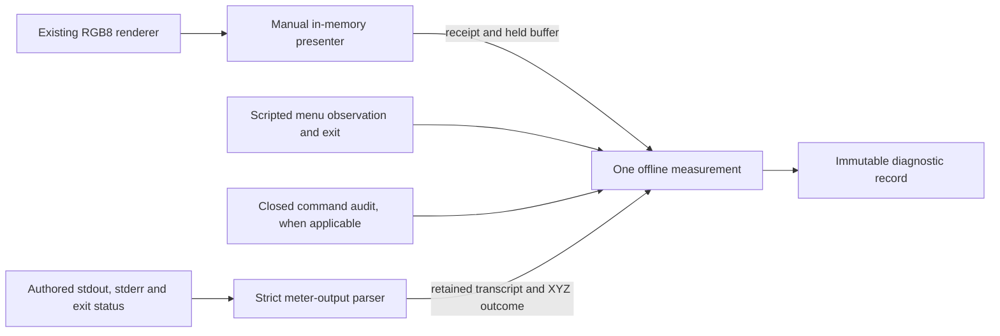

# Software integration design and offline contracts

**Software only; no hardware operation or physical-test authorisation.** This slice connects explicit fixture evidence for a patch, a menu observation, a command audit and a complete meter transcript. It opens no window, enumerates no display/device, starts no process and opens no serial port. It supplies no physical adapter or real-mode switch.

Prepared by Codex (OpenAI), 27 October 2026, under the [verbatim owner request](../briefs/2026-10-27-software-integration.md) (S-041). Base: merged PR #22, `8a299da05e30da2ec88a77538e35416d9ef8d51e`, whose files match reviewed head `9e6b49b6e76b210dc7d8401c9bc413131336afe1`. Design and software results are S-042/C-094/T-016, not equipment evidence. Source-format inspection is S-043/C-095.

The existing protocol prototype, renderer and toy cycle remain unchanged. This work adds the integration boundary around independent observations; it does not silently turn the earlier toy TV's hidden-state checks into physical capabilities. The full application, optimiser and hardware-facing implementations remain future work.

## Technical choices

| Choice | Reason and practical limit |
|---|---|
| Standard-library Python; concrete offline classes | No new installation, dependency, callback, plug-in loader or arbitrary adapter can reach equipment through these APIs. This is a code boundary, not a sandbox against arbitrary Python modification. |
| Reuse the existing renderer without edits | Keeps D-018's exact centre and 6.25% area, and retains its independently reviewed pixel tests. One immutable current RGB8 buffer is kept, plus small hash receipts. |
| Explicit selection, confirmation and manual advance | Construction and selection produce no image. A fixture name is never an OS display identifier. No timer advances patches and no patch-only operation sends a TV command. |
| One fake monotonic clock shared by every component | Timestamp comparisons have one domain. Methods do not sleep or advance the clock. Two seconds remains a proposed simulation policy, not a Q-008 result. |
| Separate command, menu, presentation and meter evidence | An ACK cannot supply the setting or prove menu exit; a frame hash cannot prove displayed light; parsing XYZ cannot establish correction validity or accuracy. |
| One command audit and one measurement attempt per object | Small, terminal state machines are reviewable. Cross-command correlation, session restoration budgets and optimisation belong to later reviewed orchestration; no automatic retry or restoration is added. |
| Bounded complete meter transcripts | Offline parsing can be verified without launching Argyll. Stream draining, process completion and safe shutdown are requirements for the later adapter, not inferred from the bytes. |
| Immutable result snapshots and explicit capacity errors | Rejected bounded evidence is retained. Overflow cannot be reported as a complete successful log. Oversized or malformed meter-transcript arguments raise before consuming an integration attempt. |
| No GUI or packaging dependency selected in this slice | Q-003's production Python, Windows framework and packaging decision needs a separate proposal tied to physical presentation requirements. Existing Python versions used for verification are not a production-support promise. Q-002 remains open before distribution; the standard library uses the PSF licence. |

## Composition and evidence flow



All inputs are authored fixtures. None is a recording from the owner's equipment. The integration API accepts concrete local fakes only, not injected physical implementations. A later hardware layer requires a new, independently reviewed implementation and its own explicit owner authorisation to run.

The public entry points live in [presentation.py](../../tv_autocal/presentation.py), [meter_output.py](../../tv_autocal/meter_output.py), [sender_audit.py](../../tv_autocal/sender_audit.py) and [integration.py](../../tv_autocal/integration.py). Tests independently supply literal values; they do not generate observations from the requested setting or simulate an optical response.

## Manual presentation contract

`ManualPresenter(clock, targets, patches)` receives immutable fixture tuples, not a display scan. Select a known native target with `select(name)`, explicitly confirm that name with `confirm(name)`, then call `advance()` once for each next patch. No buffer is generated before advance. Non-native dimensions fail before rendering; there is no scaling fallback. A target cannot change after the first buffer. Sequence exhaustion rejects another advance without looping.

The approved rectangle remains **960×540 at x=1440…2399, y=810…1349 on 3840×2160**, exactly centred and covering **6.25%** of the area. `render_patch` and its literal geometry test are untouched. This patch-only fixture list complements the existing visual-pattern manifest; it is not a fullscreen presenter or a complete timed T-003/T-005 programme.

Each `PresentationReceipt` retains sequence, synthetic target, RGB, buffer-generation time and SHA-256; `displayed_on_hardware` is always false. `presented_ms` names fake buffer generation, not a displayed frame. Targets are capped at 16 and patches at 256; only the current large frame is retained.

`hold(sequence)` returns a fresh ownership token. Advancement is blocked while held. `release(sequence, token)` requires both values, so a stale attempt cannot release a later hold of the same frame. Close/cancel clears the current buffer and hold but keeps receipts; reopening is impossible. These are in-memory ownership checks, not screen monitoring.

## Meter-output contract and consulted source

`parse_meter_output(stdout, stderr, exit_code, timed_out=False, cancelled=False)` accepts complete immutable byte transcripts, not a process handle. Each stream is capped at 65,536 bytes. Type/size errors raise before use; bounded process-error transcripts return a rejected immutable `MeterOutput` retaining raw stdout/stderr and exit status. A successful parse requires clean completion, empty stderr and exactly one complete, newline-terminated supported result. XYZ and the three accompanying values must be finite. Finite zero/negative XYZ remain diagnostic data only.

Supported ASCII result forms are `Result is XYZ: X Y Z, D50 Lab: L a b` and `Result is XYZ: X Y Z, Yxy: Y x y`. The latter matches the `-x` option already proposed in T-003. `output_format` identifies the accepted form. Ordinary prompts are tolerated; warning/error diagnostics, malformed or duplicate result lines, alternate/reference modes, non-ASCII/control bytes, incomplete output, nonzero/missing exit status, timeout and cancellation reject acceptance. Signed decimal/scientific fixture numbers are accepted; the consulted C formatter uses `%f`. This grammar neither verifies invocation options nor establishes the installed binary's behaviour.

S-043 reuses the read-only [ArgyllCMS V3.5.0 source archive](https://www.argyllcms.com/Argyll_V3.5.0_src.zip) retrieved for S-037, SHA-256 `f8576ce5589fd15620abb73ff049ea31f55ddbd1bba6d1ffa87452658e7bc85f`. Consulted on 27 October 2026: `spectro/spotread.c` line 636 supplies the default D50 label; lines 521 and 976–979 describe/select `-x`; lines 2965–2984 emit the Y, Yxy, LCh, Yuv and XYZ/Lab forms. The exact Yxy formatter is at 2969–2970, default XYZ/Lab at 2983–2984. Only source was read; no Argyll command, even help, was executed. No downloaded source or binary is committed. C-090/C-091's startup probing and correction-environment requirements remain unchanged.

A later process adapter must capture both streams through actual process exit/closure and preserve partial/error output, enforce bounded memory, and report outstanding processes without automatic kill/restart. The offline parser does not implement any of that lifecycle, serial isolation or driver behaviour. Unsupported formats must produce an explicit rejection, not be silently coerced to a different profile.

## Command-audit contract

`SenderAudit(clock)` has no transport. It records one instantaneous synthetic write and manually fed receive bytes through explicit simulated close. `CandidateCommand` admits only the three [T-006 candidate frames](../tests/T-006-exlink.md#consulted-evidence-and-candidate-bytes): EXIT, Contrast 94 and restoration to 95. These are worksheet-derived hypotheses, not captured traffic or authorised commands. The older T-009 allowlist stays unchanged; raw arbitrary frames and real-mode/port options are rejected.

`submit(command, accepted_bytes=7)` records the requested bytes and synthetic accepted count. Partial writes stop without retry. `feed(bytes)` records arrival at current fake time; `poll()` observes an exclusive reply deadline. A reply exactly at the deadline is late. ACK is provisional until `close()`: duplicate, trailing or later bytes invalidate success. NACK, malformed data, timeout and cancellation cannot be revived by a later ACK. Received bytes continue to be recorded after those outcomes until close. After close, input raises explicitly rather than disappearing silently.

`accepted` requires a closed ACK audit and a complete log; it establishes no changed setting or menu exit. The existing reply parser permits chunks up to 96 bytes; larger chunks are retained within the audit bounds but rejected by the parser. A real adapter would need a reviewed chunking and draining policy.

The default log caps are 4,096 total requested/received bytes and 256 events; configurable limits are bounded. Overflow retains the available prefix and a marker, sets UNKNOWN/incomplete, counts omitted bytes, and reserves the close marker. Event overflow can invalidate completeness even when `dropped_bytes` is zero, because a status event may be missing. Do not equate a zero omitted-byte count with a complete audit.

This model has no initial quiet interval, physical port configuration, modem-line behaviour, real write duration, drain interval, cross-command correlation, noise recovery or reopen policy. Closing immediately after a supplied ACK proves only that fixture's closure, not that all future hardware bytes were drained. Those requirements remain open for the future physical sender and T-006.

## One-attempt integration contract

`OfflineMeasurement(clock, presenter)` requires the same concrete clock as its presenter and any supplied sender audit. `begin(MenuObservation(...), command=optional_audit)` takes a hold on the current explicitly selected/confirmed frame. The observation provides inspection time, exit time/confirmation and an optional independently supplied fixture setting. No hidden TV state is read, and no readback or overlay-detection capability is assumed.

An optional command audit must already be closed, accepted and complete. Its events and closure time are snapshotted even if later exit validation rejects the attempt. Observation cannot predate command closure. Contrast 94/restoration 95 require matching independently supplied menu values; ACK alone does not satisfy that check. EXIT still needs explicit exit confirmation. Patch-only reads require no command, and an already-confirmed exit can be reused for later manually requested patches/repeats with a fresh wait.

The wait begins at `begin`, after the buffered frame and confirmed exit, so a delayed start waits conservatively again. `poll()` neither advances time nor advances patches. Once the wait elapses it enters READING and records a fresh read-start/deadline. `finish(stdout, stderr, exit_code)` consumes a complete supplied transcript only while READING; arrival at the exact deadline is rejected. Unlike the earlier toy meter's scheduled-arrival model, this boundary has no earlier arrival timestamp to infer from delayed polling.

Success releases the hold and produces an immutable diagnostic record. The caller must explicitly advance a patch or create another one-attempt object to repeat it. The record retains frame identity/hash, observation, command/audit snapshot, timing, raw meter evidence and acceptance/rejection reason. A passing parser result inside a rejected integration record does not override the outer rejection.

Failure/cancellation closes only the presentation still owned by that attempt. Lost or replaced ownership stops the stale attempt without closing/releasing another attempt's frame. Cancellation before begin records no measurement because none began. Stops are terminal; there is no automatic next reading, setter, retry or restoration. After a terminal timeout, a later transcript is explicitly refused; no process exists in this harness, and the future process adapter must independently retain/drain its output. This object is not a replacement for the toy controller's session-wide restoration tracking.

The integration regression composes an explicit baseline observation of 95, a Contrast 94 audit/observation, and a restoration-to-95 audit/observation. It supplies identical XYZ literals throughout to avoid implying a physical model or measured improvement. This demonstrates evidence sequencing only; it does not pass T-006 or T-013 and does not implement an optimisation loop.

## Offline validation

Run the existing manual test entry point from the repository root using an installed interpreter:

```text
py -3.15 -B -m unittest discover -s tests -v
```

No dependency installation, new automation or device setup is needed. The existing recursive-source test creates inert temporary Python text but never imports it. Application import checks and guarded functional reruns reject file/device opens, process launches and networking. They supplement code inspection and the absence of real adapters; they are not a general Python security sandbox.

The complete suite was run manually on 27 October 2026:

| Run | Interpreter | Passed | Failed | Errors | Skipped | Unrun |
|---|---|---:|---:|---:|---:|---:|
| Complete suite, files identified below | Python 3.12.14 | 148 | 0 | 0 | 0 | 0 |
| Same files | Python 3.15.0 | 148 | 0 | 0 | 0 | 0 |

The 148 distinct tests comprise 39 T-009, 11 renderer, 38 toy-cycle, two earlier composition/demo, one guarded-suite, 13 presentation, 12 meter-output, 17 sender-audit and 15 integration tests. Guards rerun 35 original protocol cases and 108 other functional cases; reruns are not additional distinct tests. Normal local temporary-directory permissions were used for the inherited inert-source regression. Nothing was installed or operated on equipment.

Checks include independent literal patch bytes, explicit selection/confirmation, stale ownership tokens, source-format XYZ/Yxy parsing, malformed extra result lines, finite values and failure transcripts, every ACK split, late/duplicate input through close, partial writes, byte/event overflow, clock/deadline boundaries, baseline/change/restore evidence, patch-only/repeated reads, cancellation and absent real-mode options.

Internal checks identified and corrected two integration defects: failed exit validation originally omitted the supplied command snapshot; a stale measurement could originally accept a re-acquired hold on the same frame. New regressions cover both. Source comparison also caught the need to accept T-003's proposed `-x` Yxy format; the parser and composition tests now cover it. Same-vendor checking is not independent review.

Existing PR #22's 91-test results and hashes are historical evidence for its identified head; its application sources remain unchanged, while the containment tests now include these additional modules. The current file hashes below identify the exact verified software without a self-referential commit hash. All Python files use LF.

| File | SHA-256 |
|---|---|
| `tv_autocal/__init__.py` | `02a4bc365fe39e9bcb75a8dc978d04ae87a249fd33d9ecda252cae1cc1ab651d` |
| `tv_autocal/cycle.py` | `82cbbe9e231d90caf94b451d1cf6713d85e9929cdc3d4711c795a3151316ab80` |
| `tv_autocal/demo.py` | `0dd82febfe3489b9ecf964377739a0643d6aa223f0d34361a87a5b5df5dd4fce` |
| `tv_autocal/exlink.py` | `d55c4ac872e95c02dd5a379e68ea4a4d7661dab63e57dd5769560f779c423596` |
| `tv_autocal/integration.py` | `56f091070e40ad29ad67ebf9c590df61b486f1814f0bca668795daa9cb3ab00c` |
| `tv_autocal/meter_output.py` | `23de206707e4998aac5b3e8b71108a7fab25336f754c3deaded88b03a9f0987c` |
| `tv_autocal/presentation.py` | `0b4ddbd5eaf6eaf533dedc194da891c171a9a00c96fe418c78e72e3d9ce71648` |
| `tv_autocal/renderer.py` | `1eaadc72e2785c3d7d96980a979469c9f26788f8a0d938ad19e5c8bc142f518f` |
| `tv_autocal/sender_audit.py` | `c0b61f096ec3fd84cdd9c8c21743f000ec849feacc0302b488f1332a9986a185` |
| `tv_autocal/simulation.py` | `bd84b7e1b597156af4ce2952fc6f2e3cfa2094d6fba1ef4e0a639406e94b69d8` |
| `tests/test_cycle.py` | `2afb23d1268e82f77a4546b1a82d784f8762c87f65e7401accaf8bfdef5d2f30` |
| `tests/test_integration.py` | `8afda185be5736d14196793263ffe9f626066322241f0def188269b83c65531f` |
| `tests/test_meter_output.py` | `ef4fd5d9abbc2cd152fa7b6ddab62fef497d8e883e1ff919a4ada373eda2a1ab` |
| `tests/test_presentation.py` | `33cfda3e4c85def864ada43b44a715c38f123b06a586843f43b30f70fb778b48` |
| `tests/test_renderer.py` | `9df6b56ef3ede15ba6b3c88c95178e97ef2ca26a7ac9a93288b7c7be5278bbab` |
| `tests/test_renderer_cycle_integration.py` | `102cff513e480922646a3d0b88933cc37888e5c30aea76e0fa50ee142c9a76d9` |
| `tests/test_sender_audit.py` | `d421d8a9c84158fe95010c85d0f853f6d951112792a05f51b0cde7953137f45e` |
| `tests/test_software_containment.py` | `0836f4c8f9523a2af9192bc1051f078feedd15bfcb0d674a778dcf2a78fa2486` |
| `tests/test_t009.py` | `3913b69c1c507b3a08f700d602ca106566c07d95cee3d7fd578847b64a2eeb74` |

## Remaining gates and independent review

Claude Code (Anthropic) or Antigravity (Google) must review this PR before the owner decides whether to merge. Internal Codex assistance is the author's vendor. Review should focus on event/byte retention through closure, provisional ACK rejection, transcript grammar and provenance, hold ownership, timing/cancellation, immutable evidence and absence of hardware paths.

T-003/T-005 still need an operational presenter with reviewed launch/close instructions and Windows colour-path evidence; an in-memory fixture selection is not a physical display selection. T-005's correct black/white range interpretation remains unresolved. T-006 still needs actual electrical evidence, scope/restoration and menu-timing amendments and a physical sender. C-090/C-091 still block unreviewed meter/serial coexistence. This code does not authorise connection or experimentation.

Q-001/T-004 correction validation, Q-002 licensing, Q-003 production implementation/packaging, Q-008 timing, X-012 setting scope and later Q-014 final targets remain open. T-013 needs its own reviewed plan and satisfactory component evidence; T-008 additionally needs correction-policy resolution and final acceptance criteria. No equipment test status changes and no purchase is proposed.
