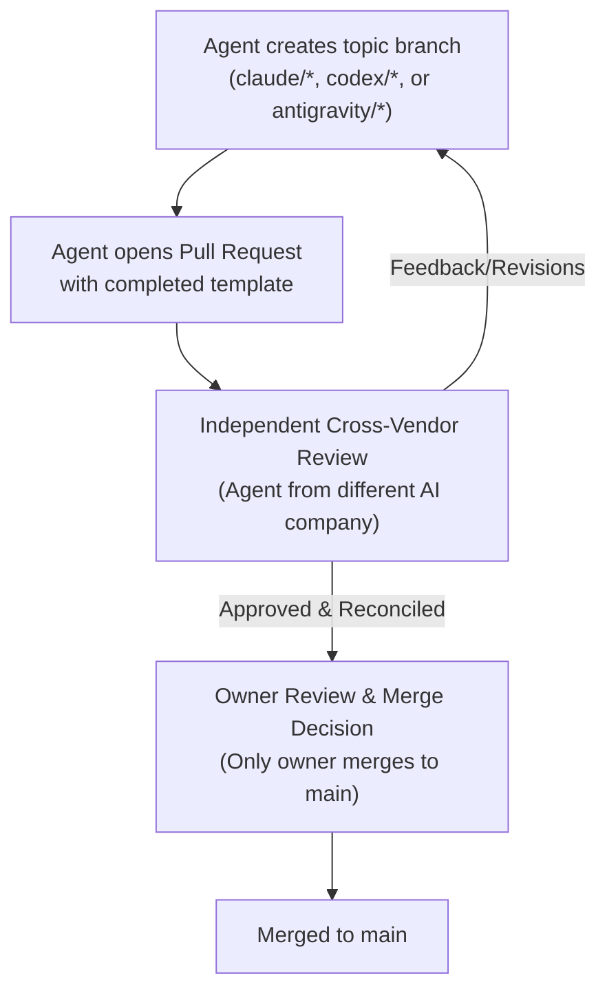

# Project Workflow & Collaboration Guide

A plain-English guide explaining how work is proposed, reviewed, tested, and accepted across the collaborative team.

---

## 1. Core Workflow Principles

Work in this repository is conducted by the owner and **three independent AI coding agents**:
* **Claude Code** (Anthropic)
* **Codex** (OpenAI)
* **Antigravity** (Google)

### Key Working Rules
1. **Never commit directly to `main`:** All proposed code, docs, and ledger updates must be submitted via pull requests.
2. **Branch Naming:**
   * Claude Code: `claude/<topic>`
   * Codex: `codex/<topic>`
   * Antigravity: `antigravity/<topic>`
3. **Cross-Vendor Peer Review Matrix:**
   * A PR authored by Claude Code is reviewed by **Codex** or **Antigravity**.
   * A PR authored by Codex is reviewed by **Claude Code** or **Antigravity**.
   * A PR authored by Antigravity is reviewed by **Claude Code** or **Codex**.
   * *Two agents from the same vendor do not count as independent reviewers.*
4. **Reviewers comment; authors commit:** Reviewers suggest changes in review discussions; they never push commits directly to another agent's branch.
5. **Only the Owner Merges:** No agent merges a pull request, force-pushes, or rewrites repository history without explicit instruction.

---

## 2. Equipment Test Authorisation Lifecycle

Under [AGENTS.md](file:///C:/Users/Kevin%20Loftus/OneDrive/ACC/tv-autocal/AGENTS.md), no agent may operate real hardware autonomously. Physical tests follow a strict 5-stage protocol:

1. **Test Plan Proposal:** An agent authors a formal test plan using [docs/tests/TEMPLATE.md](tests/TEMPLATE.md) detailing exact steps, allowed commands, failure conditions, and restoration procedures, submitting it via PR.
2. **Cross-Vendor Review:** Another vendor's agent audits the plan for equipment safety, stop rules, and D-013 measurement cycle compliance.
3. **Owner Authorisation:** The owner reviews the plan and provides explicit written approval with permitted steps (e.g., *"Authorised by the owner on [Date], steps 1–4 only"*).
4. **Execution:** Steps are carried out strictly as written, with the owner present. Testing halts immediately upon any unexpected result or at the owner's instruction.
5. **Observation Logging:** Actual measurements, failure logs, and firmware states are recorded in the test plan and summarised in [LEDGER.md](../LEDGER.md).

*Software-only simulations (such as mock Ex-Link byte encoding) require no hardware authorisation because they have zero physical I/O.*

---

## 3. Essential Technical Terms

* **Closed-Loop TV-Side Calibration:** Calibrating the TV's own native hardware menus (backlight, white balance, CMS) via serial commands based on real-time probe measurements, rather than adjusting output video on the PC.
* **Ex-Link:** Samsung's 3.5mm RS-232 serial control protocol used to adjust user picture settings via 7-byte binary commands at 9600 8N1.
* **D-013 Measurement Cycle:** The mandatory sequence `[Change Setting -> Exit TV Menu -> Settle Delay -> Take Reading]`. Prevents on-screen menu graphics from contaminating optical probe readings.
* **ArgyllCMS:** Free, open-source color management suite. Its `spotread -O` tool takes single spot readings from the Datacolor Spyder5 colorimeter.
* **CCSS (Colorimeter Calibration Spectral Set):** A spectral correction profile tailored to the TV's quantum-dot backlight, allowing the Spyder5 colorimeter to read colors accurately.
* **$\Delta E_{2000}$ (Delta E):** Standard formula for perceptual color difference. A value $\le 1.0$ is generally imperceptible to the human eye.
